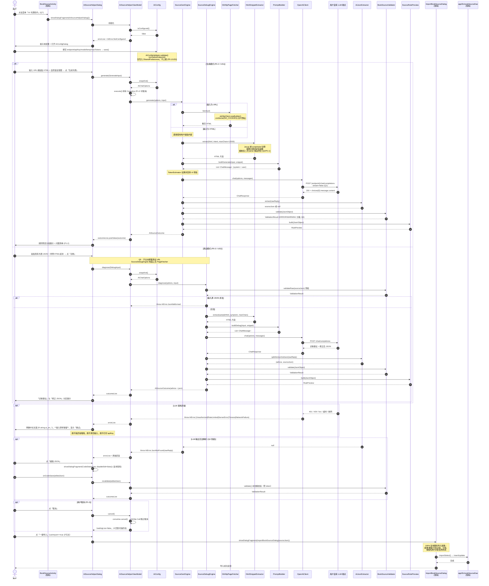
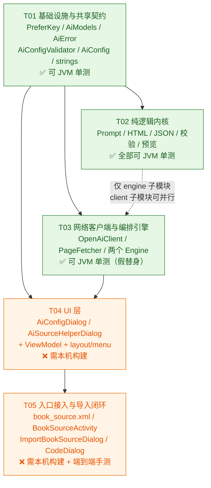

# AI 书源生成/调试助手 v1 — 系统架构设计 + 任务分解

> 文档类型：系统设计（Implementation Approach / File List / Class Diagram / Sequence Diagram）+ 任务分解
> 产出角色：架构师 高见远（Gao）
> 日期：2026-08-05
> 上游输入：`2026-08-05-ai-booksource-assistant-design.md`（收敛设计）、`2026-08-05-ai-booksource-assistant-prd.md`（PRD）
> 目标工程：`legado-Z`（阅读Sigma Android 主工程，`namespace = io.legado.app`）

---

## 0. 摘要（TL;DR）

| 维度 | 结论 |
|------|------|
| 新增运行时依赖 | **0 个**（100% 复用 OkHttp / Gson / Jsoup / Coroutines / Material） |
| 测试支持 | 沿用 JUnit、`kotlinx-coroutines-test` 与 Robolectric；TLS 测试增加 MockWebServer，与现有 OkHttp 版本对齐 |
| HTTP | **裸 OkHttp 5.3.2**；模型请求使用隔离的 `aiHttpClient`，网页抓取复用 `okHttpClient` 派生。**不引 Retrofit** |
| JSON | **Gson**（`io.legado.app.utils.GSON`）。项目已在 `libs.versions.toml` 中注释掉 kotlinx.serialization，属明确弃用 |
| 配置存储 | **SharedPreferences**（`PreferKey` + `getPrefString/putPrefString`），沿用 `AppConfig` 单例范式。**不引 DataStore** |
| 新增包 | `io.legado.app.ai`（纯逻辑内核）+ `io.legado.app.ui.ai`（UI 层） |
| 文件规模 | 新增 39 个 / 修改 6 个 |
| 任务数 | 5 个（T01~T05） |
| 可 JVM 单测 | T01 / T02 / T03 完全可测；T04 / T05 需本机构建验证 |

**架构第一原则（贯穿全文）**：`io.legado.app.ai` 下的 `prompt/` `html/` `source/` `engine/` `client/` 四层 **禁止引用任何 Android API**（`appCtx`、`Context`、`TextUtils`、Room 实体等），只依赖 Kotlin stdlib + Gson + Jsoup + OkHttp + Coroutines。这是"沙箱内可跑 JVM 单测"的硬性前提，也是本设计所有拆分决策的根因。

---

## 1. 实现方案（Implementation Approach）

### 1.1 技术难点分析

| # | 难点 | 应对 |
|---|------|------|
| D1 | **沙箱无法编译 Android**，但 P0-1/P0-2/P0-3/P0-5/P1-1 都要求可单测 | 把"编排 + 解析 + 校验 + 组装"全部下沉为**无 Android 依赖的纯 Kotlin 类**，Android 只做壳（ViewModel/Dialog）。所有跨边界依赖用**接口**（`AiChatClient`、`PageFetcher`）注入，测试用假实现替换 |
| D2 | **`BookSource` 是 Room + `@Parcelize` 实体**，直接在 JVM 单测里反序列化它会拖入 `android.os.Parcelable` / `TextUtils` 桩 | 校验层**只操作 `com.google.gson.JsonObject`**（`BookSourceValidator`），不构造 `BookSource`。真正的 `GSON.fromJsonObject<BookSource>()` 只发生在 Android 侧的导入环节。用一个反射覆盖测试（`BookSourceSchemaCoverageTest`）防止 schema 常量与实体字段漂移 |
| D3 | **LLM 输出不可靠**：带 markdown 围栏、前后解说、尾随逗号、截断 | 三级兜底（见 §1.4 Q4）：容错抠 JSON → 校验分级 → 可编辑重校验 / 可重试 |
| D4 | **token 必须省** | 只发"HTML 片段 + 意图"。Jsoup 剥离 `script/style/svg/noscript/iframe/注释` → 意图关键词定位候选容器 → 长度截断 → **用 Jsoup 二次 parse 后 `outerHtml()` 输出**，天然保证标签闭合（不做手写括号配平）。`TokenEstimator` 中英混合估算并在 UI 上预告"约 X tokens" |
| D5 | **隐私红线**：不得抓到登录态、不得回显/落日志 apiKey | 抓页用 `CookieJar.NO_COOKIES` 派生客户端；调试场景**结构上不注入 `PageFetcher`**（构造函数就没有这个参数），编译期杜绝误抓；日志统一走 `AiChatOptions.maskedKey()` |
| D6 | **endpoint 拼接**是经典 bug 源（`/v1` vs `/v1/` vs 已含 `/chat/completions`） | 抽成纯函数 `AiConfigValidator.normalizeEndpoint()` + `AiChatOptions.chatCompletionsUrl()`，重点单测覆盖 |

### 1.2 框架选型与理由

| 关注点 | 选型 | 理由（基于现有代码约定） |
|--------|------|------------------------|
| HTTP 客户端 | **裸 OkHttp**；模型使用 `aiHttpClient`，网页抓取从 `io.legado.app.help.http.okHttpClient` 派生 | 模型请求承载付费密钥与正文，专用客户端保留平台 TLS / 主机名验证，关闭自动重定向，并隔离书源 / Cronet 拦截器。网页抓取保留原配置与连接池。 |
| 挂起封装 | `OkHttpUtils.kt` 的 `newCallStrResponse()` / `newCallResponse()`（内部 `suspendCancellableCoroutine`） | 项目既有约定，天然支持协程取消（满足 P1-3） |
| JSON | **Gson**：`GSON`（宽松、`disableHtmlEscaping`、`setPrettyPrinting`）解析 LLM 输出与预览；`GSONStrict` 仅在需要严格模式时使用 | `libs.versions.toml` 第 188-189 行 kotlinx-serialization 已被注释；`BookSource.Converters`、`ImportBookSourceViewModel` 全用 Gson。混用会造成两套注解体系 |
| HTML 解析 | **Jsoup 1.16.2**（已有依赖） | ⚠️ 注意 `libs.versions.toml` 第 48-51 行注释：**不要升级 jsoup**（issue #3811 破坏性变更）。本设计只用 `Jsoup.parse` / `select` / `outerHtml` / `text`，不触及变更面 |
| 协程 | kotlinx-coroutines + 项目链式封装 `io.legado.app.help.coroutine.Coroutine` + `BaseViewModel.execute()` | `BaseViewModel.execute{}` 返回 `Coroutine<T>`，自带 `onSuccess/onError/onFinally/cancel`，正好满足 P0-5（错误分支）与 P1-3（取消） |
| 配置存储 | **SharedPreferences**（`AiConfig` object + `PreferKey` 常量 + `utils/PrefsExtensions` 的 `getPrefString/putPrefString`） | 见 §1.4 Q3 决策依据 |
| UI 骨架 | `BaseDialogFragment(layoutRes, true)` + `viewBinding` 委托 + `by viewModels<>()` + `RecyclerAdapter` | 与 `ServerConfigDialog` / `ImportBookSourceDialog` 完全同构 |
| 架构模式 | **MVVM**（Dialog ↔ ViewModel(LiveData) ↔ 纯 Kotlin Engine） | 工程既有模式；额外增加"纯 Kotlin Engine"一层作为可测边界 |

### 1.3 复用清单（显式对齐现有类，避免重复造轮子）

| 能力 | 复用的现有类 / 文件 | 说明 |
|------|--------------------|------|
| 书源数据结构 | `io.legado.app.data.entities.BookSource` + `data.entities.rule.{SearchRule, ExploreRule, BookInfoRule, TocRule, ContentRule}` | Schema 白名单从这些类反射派生（测试断言），prompt 中的字段说明也以此为准 |
| **书源导入链路** | ⚠️ **`io.legado.app.ui.association.ImportBookSourceDialog` + `ImportBookSourceViewModel`** | **修正**：设计文档/PRD 中写的 `AddBookSourceDialog` 在本仓库**不存在**。正确入口是 `ImportBookSourceDialog(source: String)`，其中 `source` 可为 JSON 字符串/URL/URI。它已内建"新增/更新/已有"识别、分组、保留名称/分组/启用状态、选择性导入等全部能力 → **一键导入 = `showDialogFragment(ImportBookSourceDialog(json))`，零新增导入代码**，天生满足 P0-4 验收项①「与手动导入完全一致」 |
| OkHttp 实例 | `io.legado.app.help.http.okHttpClient`、`OkHttpUtils.newCallStrResponse` | 见上 |
| Gson 实例 | `io.legado.app.utils.GSON` / `GSONStrict` / `fromJsonObject` / `fromJsonArray`（`GsonExtensions.kt`） | |
| 偏好读写 | `io.legado.app.utils.{getPrefString, putPrefString, getPrefInt, getPrefBoolean, removePref}`、`io.legado.app.constant.PreferKey`、`io.legado.app.help.config.AppConfig`（范式参考） | |
| 用户自配远端服务 UI 范式 | `io.legado.app.ui.book.import.remote.ServerConfigDialog`（password 输入 `InputType.TYPE_TEXT_VARIATION_PASSWORD`、toolbar `menu_save`、`R.menu.server_config`）；`io.legado.app.ui.book.read.config.HttpTtsEditDialog` | apiKey 输入框直接照抄 `ServerConfigDialog` 第 100-101 行的 password 处理 |
| 协程作用域 | `BaseViewModel.execute()` / `viewModelScope` / `io.legado.app.help.coroutine.Coroutine` | |
| **JSON 查看/编辑器** | `io.legado.app.ui.widget.dialog.CodeDialog(code, disableEdit=false, requestId)` + `CodeDialog.Callback.onCodeSave` | 直接满足 Q4「用户手动改 JSON 后本地重校验」与 P1-2「复制 JSON」，无需自研编辑器（`ImportBookSourceDialog` 第 301-310 行即此用法） |
| 等待/提示 | `io.legado.app.ui.widget.dialog.WaitDialog`、`io.legado.app.lib.dialogs.alert`、`io.legado.app.utils.toastOnUi`、`io.legado.app.constant.AppLog` | |
| 入口 Activity | `io.legado.app.ui.book.source.manage.BookSourceActivity`（`onCompatCreateOptionsMenu` / `onCompatOptionsItemSelected` / `showDialogFragment`） | |
| 列表适配器基类 | `io.legado.app.base.adapter.RecyclerAdapter` + `ItemViewHolder` | 规则预览列表 |

### 1.4 待确认问题的架构裁决（Q1~Q8）

> 团队已授权我在架构层拍板。以下为**已定方案**；仍需用户/PM 二次确认的点集中在 §8。

| # | 裁决 | 理由 / 实现落点 |
|---|------|----------------|
| **Q1** | **一次性（one-shot）**。`AiChatClient` 接口预留 `fun chatStream(...): Flow<ChatDelta>`，v1 由 `OpenAiClient` 给出默认实现直接抛 `AiError.StreamNotSupported`；请求体固定 `stream = false` | 接口先立、实现后补，后续加流式不改调用方签名。UI 侧用 `WaitDialog` + 取消按钮覆盖等待体验 |
| **Q2** | **长度截断 + Jsoup 结构化保护**，默认上限 **12000 字符**，暴露为配置项 `htmlMaxChars`（高级项，默认 12000，范围 2000~64000）。意图关键词定位（`intent` 分词后在 DOM 中打分选容器）作为同一个类里的可选路径，默认开启但降级安全 | 落在 `HtmlSnippetExtractor`；`TokenEstimator` 给出中英混合估算（CJK ≈ 1.5 char/token，ASCII ≈ 4 char/token）用于 UI 预告 |
| **Q3** | **SharedPreferences**（`AiConfig` object + `PreferKey` 新增常量） | ① 工程**零 DataStore 依赖**，引入 = 新增依赖 + 新增异步读写范式，收益为负；② `Server`/`HttpTTS` 落 DB 是因为它们是**多实例**（用户可存多个 WebDAV / 多个 TTS 引擎），而 AI 配置 v1 是**单实例全局配置**，语义等同 `AppConfig`；③ `AppConfig` 已是成熟的"全局单例偏好"范式，直接同构。**若将来要支持多套模型配置切换，再迁移到 Room 实体 `AiProvider`**（迁移成本已被 `AiChatOptions` 这层 DTO 隔离） |
| **Q4** | **三级兜底**：① `AiJsonExtractor` 容错抠取（剥 ```json 围栏 → 取首个花括号平衡块 → 容忍尾随逗号）；② 抠不出/校验不过 → 结果区**同时展示原始回复 + 分级问题清单**，并提供「编辑 JSON」按钮（复用 `CodeDialog`）→ 用户改完 `onCodeSave` 触发**本地重校验**（零 token）；③ 「重试」按钮保留全部输入原样重发。**可选的自动修复重试**（`temperature=0` + "只输出 JSON，不要解释" 的修复 prompt，最多 1 次）由配置开关 `autoRepair` 控制，**默认关闭**（避免默默烧 token） | 落在 `AiJsonExtractor` + `SourceGenEngine` + UI |
| **Q5** | **采纳**。调试场景**不主动抓取**：`SourceDebugEngine` 的构造函数**不接受 `PageFetcher`**，编译期杜绝。生成场景：用户给 URL → `OkHttpPageFetcher` 抓（`CookieJar.NO_COOKIES`、不带任何登录态、UA 用 `AppConfig.userAgent`）；用户给 HTML → 直接用 | |
| **Q6** | **两级校验**。**ERROR（阻断导入，导入按钮置灰）**：JSON 顶层非对象 / `bookSourceUrl` 缺失或非 `http(s)` 绝对地址 / `bookSourceName` 空白 / `bookSourceType` 非 0-4 整数。**WARNING（可继续导入）**：`searchUrl` 缺失、`ruleSearch`/`ruleToc`/`ruleContent` 三者全缺、出现 `BookSource` 未定义的顶层字段（会被 Gson 静默丢弃）、`ruleSearch.bookList` 等关键子规则缺失。**允许"草稿态"预览**（ERROR 也照样把 JSON 与问题清单展示出来，只是不给导入） | 落在 `BookSourceValidator`，返回 `ValidationResult` |
| **Q7** | **`res/menu/book_source.xml` 新增 `menu_ai_source_assistant`**，插入位置：`menu_add_book_source` 之后、`menu_import_local` 之前，`app:showAsAction="never"`，icon 复用 `@drawable/ic_add`（或新增 `ic_ai`）。处理落点：`BookSourceActivity.onCompatOptionsItemSelected()` 第 190 行附近新增分支 → `showDialogFragment<AiSourceHelperDialog>()` | 与"新建书源/导入本地/在线导入/二维码导入"同处一个菜单组，认知负担最低；`BookSourceActivity` 已有 `showDialogFragment(ImportBookSourceDialog(...))` 的现成范式 |
| **Q8** | **v1 不做**导入前实测抓取 | 需要拉起 `BookSourceDebugModel` 全链路，范围爆炸。留待 v1.1，可直接复用现有 `ui/book/source/debug/BookSourceDebugActivity` |

---

## 2. 文件列表（File List）

> 路径均相对于仓库根 `legado-Z/`。
> 标记：🆕 新增 / ✏️ 修改 / ✅ 可 JVM 单测（不含 Android API）/ 📱 需本机构建验证

### 2.1 纯逻辑内核 `io.legado.app.ai`（✅ 全部无 Android 依赖）

| 状态 | 路径 | 职责 |
|------|------|------|
| 🆕✅ | `app/src/main/java/io/legado/app/ai/AiModels.kt` | 跨层共享数据模型：`AiChatOptions`、`ValidationIssue`、`IssueLevel`、`ValidationResult`、`AiSourceOutcome`、`RulePreview`、`RulePreviewGroup`、`RulePreviewEntry`、`GenerateInput`、`DebugInput` |
| 🆕✅ | `app/src/main/java/io/legado/app/ai/AiError.kt` | `sealed class AiError : Exception`，统一错误类型 + `messageRes` 映射 |
| 🆕✅ | `app/src/main/java/io/legado/app/ai/AiConfigValidator.kt` | `object`，纯校验：`validate(AiChatOptions): ValidationResult`、`normalizeEndpoint(String): String` |
| 🆕📱 | `app/src/main/java/io/legado/app/ai/AiConfig.kt` | `object`，SharedPreferences 读写壳（**唯一触碰 `appCtx` 的 ai 包文件**）：`snapshot()` / `save()` / `isConfigured()` / `clear()` |
| 🆕✅ | `app/src/main/java/io/legado/app/ai/client/ChatModels.kt` | OpenAI 兼容 DTO：`ChatRequest`、`ChatMessage`、`ChatResponse`、`Choice`、`Usage`、`ChatDelta`、`ApiErrorBody`（Gson `@SerializedName` 处理 snake_case） |
| 🆕✅ | `app/src/main/java/io/legado/app/ai/client/AiChatClient.kt` | `interface`：`suspend fun chat(options, messages): ChatResponse`；`fun chatStream(...): Flow<ChatDelta>`（默认抛 `AiError.StreamNotSupported`）；`suspend fun ping(options): Boolean`（P1-4 连通性测试） |
| 🆕✅ | `app/src/main/java/io/legado/app/ai/client/OpenAiClient.kt` | 实现类，构造参数为 `okhttp3.Call.Factory`（**注入式**，测试可传假实现，零 Android 依赖）；负责 URL 拼接、Header、超时、HTTP 状态码 → `AiError` 映射 |
| 🆕✅ | `app/src/main/java/io/legado/app/ai/prompt/PromptTemplates.kt` | **全部 prompt 常量的唯一存放地**（`SYSTEM_GENERATE` / `SYSTEM_DEBUG` / `SYSTEM_REPAIR` / `RULE_FIELD_CHEATSHEET`） |
| 🆕✅ | `app/src/main/java/io/legado/app/ai/prompt/PromptBuilder.kt` | `object`：`buildGenerate(GenerateInput, snippet): List<ChatMessage>`、`buildDebug(DebugInput, snippet): List<ChatMessage>`、`buildRepair(rawReply, issues): List<ChatMessage>` |
| 🆕✅ | `app/src/main/java/io/legado/app/ai/html/HtmlSnippetExtractor.kt` | Jsoup 剥噪 + 意图定位 + 长度截断 + 二次 parse 保证闭合。`extract(html, intent, maxChars): String` |
| 🆕✅ | `app/src/main/java/io/legado/app/ai/html/TokenEstimator.kt` | `estimate(text): Int`（CJK/ASCII 分权），`estimateMessages(List<ChatMessage>): Int` |
| 🆕✅ | `app/src/main/java/io/legado/app/ai/source/BookSourceSchema.kt` | `BookSource` 顶层字段白名单 + 必填集 + 规则子对象字段表（常量），供校验与 prompt cheatsheet 共用 |
| 🆕✅ | `app/src/main/java/io/legado/app/ai/source/AiJsonExtractor.kt` | 从 LLM 自由文本中抠出 JSON：`extract(raw): String?`、`splitAdviceAndJson(raw): Pair<String, String?>` |
| 🆕✅ | `app/src/main/java/io/legado/app/ai/source/BookSourceValidator.kt` | **只吃 `JsonObject`**，输出 `ValidationResult`（ERROR/WARNING 分级，Q6） |
| 🆕✅ | `app/src/main/java/io/legado/app/ai/source/SourceRulePreview.kt` | `JsonObject` → `RulePreview`（基础信息 / 搜索 / 发现 / 书籍信息 / 目录 / 正文 五组） |
| 🆕✅ | `app/src/main/java/io/legado/app/ai/engine/PageFetcher.kt` | `interface PageFetcher { suspend fun fetch(url: String): String }` + `class OkHttpPageFetcher(callFactory)` 实现（📱 实现类需本机验证，接口本身可测） |
| 🆕✅ | `app/src/main/java/io/legado/app/ai/engine/SourceGenEngine.kt` | 生成编排：抓取(可选) → 截片段 → 组 prompt → 调 LLM → 抠 JSON → 校验 → 预览。全程 `ensureActive()` 支持取消 |
| 🆕✅ | `app/src/main/java/io/legado/app/ai/engine/SourceDebugEngine.kt` | 调试编排：**无 fetcher**（Q5），源 JSON 预检 → 组 prompt → 调 LLM → 拆"建议/JSON" → 校验 → 预览 |

### 2.2 UI 层 `io.legado.app.ui.ai`（📱 全部需本机构建验证）

| 状态 | 路径 | 职责 |
|------|------|------|
| 🆕📱 | `app/src/main/java/io/legado/app/ui/ai/AiConfigDialog.kt` | 配置页，仿 `ServerConfigDialog`：endpoint/apiKey(password)/model/temperature/maxTokens/htmlMaxChars/autoRepair + toolbar「保存」「测试连接」 |
| 🆕📱 | `app/src/main/java/io/legado/app/ui/ai/AiConfigViewModel.kt` | 校验（委托 `AiConfigValidator`）、保存（`AiConfig.save`）、`testConnection()`（P1-4，委托 `AiChatClient.ping`） |
| 🆕📱 | `app/src/main/java/io/legado/app/ui/ai/AiSourceHelperDialog.kt` | 主对话框：生成/调试 Tab 切换、输入区、结果区（规则预览 + 原始回复 + 问题清单）、复制/编辑/重试/导入按钮、⚙配置入口 |
| 🆕📱 | `app/src/main/java/io/legado/app/ui/ai/AiSourceHelperViewModel.kt` | 持有 `Coroutine<*>` 以支持取消（P1-3）；组装 Engine 依赖；`LiveData<AiSourceOutcome>` / `LiveData<AiError>`；`revalidate(editedJson)`（Q4 ②） |
| 🆕📱 | `app/src/main/java/io/legado/app/ui/ai/RulePreviewAdapter.kt` | 基于 `RecyclerAdapter` 的规则分组预览列表（P1-2） |

### 2.3 资源文件

| 状态 | 路径 | 说明 |
|------|------|------|
| 🆕📱 | `app/src/main/res/layout/dialog_ai_config.xml` | 参考 `dialog_webdav_server.xml` |
| 🆕📱 | `app/src/main/res/layout/dialog_ai_source_helper.xml` | Toolbar + TabLayout + 输入区 + RecyclerView 结果区 + 底部按钮条 |
| 🆕📱 | `app/src/main/res/layout/item_ai_rule_preview.xml` | 规则预览条目（分组标题 + key/value） |
| 🆕📱 | `app/src/main/res/menu/ai_config.xml` | `menu_save` / `menu_test_connection`（参考 `server_config.xml`） |
| 🆕📱 | `app/src/main/res/menu/ai_source_helper.xml` | `menu_ai_config` / `menu_copy_json` / `menu_edit_json` |
| ✏️📱 | `app/src/main/res/menu/book_source.xml` | **新增 `menu_ai_source_assistant`**（Q7 入口） |
| ✏️📱 | `app/src/main/res/values/strings.xml` | 新增全部 `ai_*` 文案（含 `ai_err_*` 错误文案） |

### 2.4 现有文件修改

| 状态 | 路径 | 改动 |
|------|------|------|
| ✏️ | `app/src/main/java/io/legado/app/constant/PreferKey.kt` | 新增 `aiEndpoint / aiApiKey / aiModel / aiTemperature / aiMaxTokens / aiTimeoutSec / aiHtmlMaxChars / aiAutoRepair` |
| ✏️📱 | `app/src/main/java/io/legado/app/ui/book/source/manage/BookSourceActivity.kt` | `onCompatOptionsItemSelected` 新增 `R.id.menu_ai_source_assistant -> showDialogFragment<AiSourceHelperDialog>()` |
| ✏️ | `app/build.gradle` | `testOptions { unitTests.returnDefaultValues = true }` + `testImplementation(libs.kotlinx.coroutines.test)` |
| ✏️ | `gradle/libs.versions.toml` | 新增 `kotlinx-coroutines-test` 坐标（复用 `coroutines = "1.10.2"` version.ref） |

### 2.5 单元测试（`app/src/test/java/io/legado/app/ai/`，✅ 沙箱内可跑）

| 状态 | 路径 | 覆盖 |
|------|------|------|
| 🆕✅ | `AiConfigValidatorTest.kt` | P0-1：endpoint 空/非 http(s)/尾斜杠/已含 `/chat/completions`；apiKey 空；temperature 越界；maxTokens 越界 |
| 🆕✅ | `PromptBuilderTest.kt` | P0-2/P0-3：system 含字段 cheatsheet；user 含片段与意图；**断言 prompt 中不含 apiKey**；调试 prompt 含源 JSON 与症状 |
| 🆕✅ | `HtmlSnippetExtractorTest.kt` | P1-1：剥 script/style/注释；超长截断到 ≤maxChars；截断后 `Jsoup.parse` 无残缺标签；意图关键词命中容器 |
| 🆕✅ | `TokenEstimatorTest.kt` | P1-1：纯中文/纯英文/混合的估算量级 |
| 🆕✅ | `AiJsonExtractorTest.kt` | P0-5：```json 围栏、前后带解说、尾随逗号、无 JSON（返回 null）、多个花括号块取首个平衡块 |
| 🆕✅ | `BookSourceValidatorTest.kt` | P0-2/P0-3/Q6：缺 `bookSourceUrl` → ERROR；缺 `searchUrl` → WARNING；未知字段 → WARNING；`bookSourceType=9` → ERROR；全合法 → 无 issue |
| 🆕✅ | `BookSourceSchemaCoverageTest.kt` | **防漂移**：反射 `BookSource::class.java.declaredFields`，断言全部被 `BookSourceSchema.TOP_LEVEL_FIELDS` 覆盖 |
| 🆕✅ | `OpenAiClientTest.kt` | 200 正常 / 401 → `Unauthorized` / 429 → `RateLimited` / 500 → `ServerError` / 空 choices → `EmptyResponse`；URL 拼接正确 |
| 🆕✅ | `SourceGenEngineTest.kt` | P0-2 全链路：假 fetcher + 假 client；抓取失败降级；LLM 返回垃圾 → `JsonNotFound`；校验 ERROR → `canImport=false` |
| 🆕✅ | `SourceDebugEngineTest.kt` | P0-3：输入非法源 JSON → 明确错误；输出「建议+JSON」正确拆分；**断言未发起任何抓取** |
| 🆕✅ | `fake/FakeAiChatClient.kt` `fake/FakeCallFactory.kt` `fake/FakePageFetcher.kt` | 测试替身（零新增依赖，不需要 MockWebServer） |

**合计：新增 39 个文件（含 11 个测试文件 + 3 个测试替身合并计入），修改 6 个文件。**

---

## 3. 数据结构与接口（Class Diagram）

> 同步导出至 `docs/plans/2026-08-05-ai-booksource-assistant-class-diagram.mermaid`

```mermaid
classDiagram
    direction TB

    %% ==================== 共享模型 (pure) ====================
    class AiChatOptions {
        +String endpoint
        +String apiKey
        +String model
        +Float temperature
        +Int maxTokens
        +Int timeoutSec
        +Int htmlMaxChars
        +Boolean autoRepair
        +chatCompletionsUrl() String
        +maskedKey() String
    }

    class IssueLevel {
        <<enumeration>>
        ERROR
        WARNING
    }

    class ValidationIssue {
        +String field
        +IssueLevel level
        +Int messageRes
        +String detail
    }

    class ValidationResult {
        +List~ValidationIssue~ issues
        +hasError() Boolean
        +errors() List~ValidationIssue~
        +warnings() List~ValidationIssue~
    }

    class RulePreviewEntry {
        +String key
        +String value
    }
    class RulePreviewGroup {
        +Int titleRes
        +List~RulePreviewEntry~ entries
    }
    class RulePreview {
        +List~RulePreviewGroup~ groups
    }

    class AiSourceOutcome {
        +String rawReply
        +String sourceJson
        +String advice
        +RulePreview preview
        +ValidationResult validation
        +Usage usage
        +Int promptTokenEstimate
        +canImport() Boolean
    }

    class GenerateInput {
        +String url
        +String html
        +String intent
        +Int maxHtmlChars
    }
    class DebugInput {
        +String sourceJson
        +String sampleHtml
        +String symptom
        +Int maxHtmlChars
    }

    %% ==================== 错误类型 (pure) ====================
    class AiError {
        <<sealed>>
        +Int messageRes
        +String detail
    }
    class NotConfigured
    class InvalidConfig
    class NetworkFailure
    class Timeout
    class Unauthorized
    class RateLimited
    class ServerError
    class EmptyResponse
    class JsonNotFound
    class JsonMalformed
    class SchemaInvalid
    class FetchFailed
    class StreamNotSupported

    AiError <|-- NotConfigured
    AiError <|-- InvalidConfig
    AiError <|-- NetworkFailure
    AiError <|-- Timeout
    AiError <|-- Unauthorized
    AiError <|-- RateLimited
    AiError <|-- ServerError
    AiError <|-- EmptyResponse
    AiError <|-- JsonNotFound
    AiError <|-- JsonMalformed
    AiError <|-- SchemaInvalid
    AiError <|-- FetchFailed
    AiError <|-- StreamNotSupported

    %% ==================== 配置层 ====================
    class AiConfigValidator {
        <<object pure>>
        +validate(AiChatOptions) ValidationResult
        +normalizeEndpoint(String) String
    }
    class AiConfig {
        <<object android>>
        +snapshot() AiChatOptions
        +save(AiChatOptions) ValidationResult
        +isConfigured() Boolean
        +clear() Unit
    }
    AiConfig ..> AiConfigValidator : 保存前校验
    AiConfig ..> AiChatOptions : 读写
    AiConfigValidator ..> ValidationResult

    %% ==================== 客户端层 (pure) ====================
    class ChatMessage {
        +String role
        +String content
    }
    class ChatRequest {
        +String model
        +List~ChatMessage~ messages
        +Float temperature
        +Int maxTokens
        +Boolean stream
    }
    class Usage {
        +Int promptTokens
        +Int completionTokens
        +Int totalTokens
    }
    class Choice {
        +Int index
        +ChatMessage message
        +String finishReason
    }
    class ChatResponse {
        +String id
        +String model
        +List~Choice~ choices
        +Usage usage
        +firstContent() String
    }
    class ChatDelta {
        +String content
        +Boolean done
    }

    class AiChatClient {
        <<interface>>
        +chat(AiChatOptions, List~ChatMessage~) ChatResponse
        +chatStream(AiChatOptions, List~ChatMessage~) Flow~ChatDelta~
        +ping(AiChatOptions) Boolean
    }
    class OpenAiClient {
        -CallFactory callFactory
        +chat(AiChatOptions, List~ChatMessage~) ChatResponse
        +chatStream(AiChatOptions, List~ChatMessage~) Flow~ChatDelta~
        +ping(AiChatOptions) Boolean
        -buildRequest(AiChatOptions, ChatRequest) Request
        -mapHttpError(Int, String) AiError
    }
    AiChatClient <|.. OpenAiClient
    ChatRequest o-- ChatMessage
    ChatResponse o-- Choice
    ChatResponse o-- Usage
    Choice o-- ChatMessage
    OpenAiClient ..> ChatRequest
    OpenAiClient ..> ChatResponse
    OpenAiClient ..> AiError : throws

    %% ==================== Prompt / HTML (pure) ====================
    class PromptTemplates {
        <<object pure>>
        +String SYSTEM_GENERATE
        +String SYSTEM_DEBUG
        +String SYSTEM_REPAIR
        +String RULE_FIELD_CHEATSHEET
    }
    class PromptBuilder {
        <<object pure>>
        +buildGenerate(GenerateInput, String) List~ChatMessage~
        +buildDebug(DebugInput, String) List~ChatMessage~
        +buildRepair(String, ValidationResult) List~ChatMessage~
    }
    class HtmlSnippetExtractor {
        <<object pure>>
        +extract(String, String, Int) String
        -stripNoise(Document) Document
        -locateByIntent(Document, String) Element
        -truncateSafely(Element, Int) String
    }
    class TokenEstimator {
        <<object pure>>
        +estimate(String) Int
        +estimateMessages(List~ChatMessage~) Int
    }
    PromptBuilder ..> PromptTemplates
    PromptBuilder ..> ChatMessage
    PromptBuilder ..> GenerateInput
    PromptBuilder ..> DebugInput

    %% ==================== 书源解析/校验 (pure) ====================
    class BookSourceSchema {
        <<object pure>>
        +Set~String~ TOP_LEVEL_FIELDS
        +Set~String~ REQUIRED_FIELDS
        +Map~String~ RULE_OBJECT_FIELDS
        +Set~String~ PREVIEW_GROUPS
    }
    class AiJsonExtractor {
        <<object pure>>
        +extract(String) String
        +splitAdviceAndJson(String) Pair
        -stripCodeFence(String) String
        -firstBalancedObject(String) String
    }
    class BookSourceValidator {
        <<object pure>>
        +validate(JsonObject) ValidationResult
        +validateRaw(String) ValidationResult
    }
    class SourceRulePreview {
        <<object pure>>
        +build(JsonObject) RulePreview
    }
    BookSourceValidator ..> BookSourceSchema
    BookSourceValidator ..> ValidationResult
    SourceRulePreview ..> BookSourceSchema
    SourceRulePreview ..> RulePreview

    %% ==================== 编排引擎 (pure) ====================
    class PageFetcher {
        <<interface>>
        +fetch(String) String
    }
    class OkHttpPageFetcher {
        -CallFactory callFactory
        +fetch(String) String
    }
    PageFetcher <|.. OkHttpPageFetcher

    class SourceGenEngine {
        -AiChatClient client
        -PageFetcher fetcher
        +generate(AiChatOptions, GenerateInput) AiSourceOutcome
        -resolveHtml(GenerateInput) String
        -parseAndValidate(String) AiSourceOutcome
    }
    class SourceDebugEngine {
        -AiChatClient client
        +diagnose(AiChatOptions, DebugInput) AiSourceOutcome
        -precheckSource(String) ValidationResult
    }
    SourceGenEngine o-- AiChatClient
    SourceGenEngine o-- PageFetcher
    SourceGenEngine ..> HtmlSnippetExtractor
    SourceGenEngine ..> PromptBuilder
    SourceGenEngine ..> AiJsonExtractor
    SourceGenEngine ..> BookSourceValidator
    SourceGenEngine ..> SourceRulePreview
    SourceGenEngine ..> AiSourceOutcome
    SourceDebugEngine o-- AiChatClient
    SourceDebugEngine ..> PromptBuilder
    SourceDebugEngine ..> AiJsonExtractor
    SourceDebugEngine ..> BookSourceValidator
    SourceDebugEngine ..> AiSourceOutcome

    %% ==================== UI 层 (android) ====================
    class AiSourceHelperDialog {
        <<BaseDialogFragment>>
        -AiSourceHelperViewModel viewModel
        -RulePreviewAdapter adapter
        +onFragmentCreated(View, Bundle) Unit
        -onGenerateClick() Unit
        -onDiagnoseClick() Unit
        -onImportClick() Unit
        -onCodeSave(String, String) Unit
    }
    class AiSourceHelperViewModel {
        <<BaseViewModel>>
        +MutableLiveData~AiSourceOutcome~ outcomeLive
        +MutableLiveData~AiError~ errorLive
        +MutableLiveData~Boolean~ loadingLive
        -Coroutine task
        +generate(GenerateInput) Unit
        +diagnose(DebugInput) Unit
        +revalidate(String) Unit
        +cancel() Unit
    }
    class AiConfigDialog {
        <<BaseDialogFragment>>
        -AiConfigViewModel viewModel
        +onMenuItemClick(MenuItem) Boolean
    }
    class AiConfigViewModel {
        <<BaseViewModel>>
        +MutableLiveData~ValidationResult~ validationLive
        +MutableLiveData~Boolean~ pingLive
        +save(AiChatOptions) Unit
        +testConnection(AiChatOptions) Unit
    }
    class RulePreviewAdapter {
        <<RecyclerAdapter>>
    }

    AiSourceHelperDialog --> AiSourceHelperViewModel
    AiSourceHelperDialog --> RulePreviewAdapter
    AiSourceHelperDialog ..> AiConfigDialog : 打开配置
    AiSourceHelperViewModel ..> AiConfig : 读配置
    AiSourceHelperViewModel --> SourceGenEngine
    AiSourceHelperViewModel --> SourceDebugEngine
    AiConfigDialog --> AiConfigViewModel
    AiConfigViewModel ..> AiConfig
    AiConfigViewModel ..> AiChatClient : ping

    %% ==================== 复用的现有类 ====================
    class BookSource {
        <<existing Room entity>>
        +String bookSourceUrl
        +String bookSourceName
        +SearchRule ruleSearch
        +TocRule ruleToc
        +ContentRule ruleContent
    }
    class ImportBookSourceDialog {
        <<existing BaseDialogFragment>>
        +ImportBookSourceDialog(String)
    }
    class BookSourceActivity {
        <<existing VMBaseActivity>>
        +onCompatOptionsItemSelected(MenuItem) Boolean
    }
    class CodeDialog {
        <<existing widget>>
        +CodeDialog(String, Boolean, String)
    }
    class okHttpClient {
        <<existing OkHttpClient singleton>>
    }
    class aiHttpClient {
        <<isolated platform TLS client>>
    }

    BookSourceActivity ..> AiSourceHelperDialog : 菜单入口 Q7
    AiSourceHelperDialog ..> ImportBookSourceDialog : 一键导入 P0-4
    AiSourceHelperDialog ..> CodeDialog : 编辑/复制 JSON Q4
    BookSourceSchema ..> BookSource : 反射覆盖测试
    OpenAiClient ..> aiHttpClient : 平台验证且无重定向
    OkHttpPageFetcher ..> okHttpClient : newBuilder NO_COOKIES
```



### 3.1 关键接口签名（Kotlin 伪代码，供 Engineer 对齐）

```kotlin
// io.legado.app.ai.client
interface AiChatClient {
    suspend fun chat(options: AiChatOptions, messages: List<ChatMessage>): ChatResponse
    fun chatStream(options: AiChatOptions, messages: List<ChatMessage>): Flow<ChatDelta> =
        throw AiError.StreamNotSupported          // Q1：接口预留，v1 不实现
    suspend fun ping(options: AiChatOptions): Boolean   // P1-4
}

// io.legado.app.ai.engine
class SourceGenEngine(
    private val client: AiChatClient,
    private val fetcher: PageFetcher?               // null = 用户直接粘贴 HTML
) {
    suspend fun generate(options: AiChatOptions, input: GenerateInput): AiSourceOutcome
}

class SourceDebugEngine(
    private val client: AiChatClient                // Q5：结构上没有 fetcher
) {
    suspend fun diagnose(options: AiChatOptions, input: DebugInput): AiSourceOutcome
}

// io.legado.app.ai.source —— 注意入参是 JsonObject 而非 BookSource（D2）
object BookSourceValidator {
    fun validate(json: JsonObject): ValidationResult
    fun validateRaw(raw: String): ValidationResult
}
```

---

## 4. 程序调用流程（Sequence Diagram）

> 同步导出至 `docs/plans/2026-08-05-ai-booksource-assistant-sequence-diagram.mermaid`
> 单图覆盖**生成**与**调试**两条主流程 + 错误/取消/兜底分支。



---

## 5. 任务列表（Task Decomposition）

> 顺序即实现顺序。标注：**PRD 需求号** / **依赖** / **是否可 JVM 单测**。
> 沙箱验证命令：`./gradlew :app:testDebugUnitTest --tests "io.legado.app.ai.*"`（T01~T03 应全绿）
> 本机验证命令：`./gradlew :app:assembleAppDebug`（T04~T05 必须由用户在本机/CI 执行）

| 任务 | 名称 | 源文件 | 覆盖 PRD | 依赖 | 优先级 | 验证方式 |
|------|------|--------|---------|------|--------|---------|
| **T01** | **基础设施与共享契约** | `gradle/libs.versions.toml`(✏️)、`app/build.gradle`(✏️)、`constant/PreferKey.kt`(✏️)、`ai/AiModels.kt`、`ai/AiError.kt`、`ai/AiConfigValidator.kt`、`ai/AiConfig.kt`、`res/values/strings.xml`(✏️ 新增 `ai_*` 全量文案)、`test/ai/AiConfigValidatorTest.kt` | P0-1、P0-5(错误类型骨架) | — | **P0** | ✅ **JVM 单测**（`AiConfigValidatorTest`）；`AiConfig.kt` 本身仅 Pref 读写，📱本机冒烟 |
| **T02** | **纯逻辑内核：Prompt / HTML / JSON / 校验** | `ai/prompt/PromptTemplates.kt`、`ai/prompt/PromptBuilder.kt`、`ai/html/HtmlSnippetExtractor.kt`、`ai/html/TokenEstimator.kt`、`ai/source/BookSourceSchema.kt`、`ai/source/AiJsonExtractor.kt`、`ai/source/BookSourceValidator.kt`、`ai/source/SourceRulePreview.kt`、`test/ai/{PromptBuilderTest, HtmlSnippetExtractorTest, TokenEstimatorTest, AiJsonExtractorTest, BookSourceValidatorTest, BookSourceSchemaCoverageTest}.kt` | P0-2(解析/校验)、P0-3(解析/校验)、P0-5(兜底分支)、P1-1、P1-2(预览模型) | T01 | **P0** | ✅ **全部 JVM 单测，本任务是沙箱内质量主战场** |
| **T03** | **网络客户端与编排引擎** | `ai/client/ChatModels.kt`、`ai/client/AiChatClient.kt`、`ai/client/OpenAiClient.kt`、`ai/engine/PageFetcher.kt`、`ai/engine/SourceGenEngine.kt`、`ai/engine/SourceDebugEngine.kt`、`test/ai/{OpenAiClientTest, SourceGenEngineTest, SourceDebugEngineTest}.kt`、`test/ai/fake/{FakeAiChatClient, FakeCallFactory, FakePageFetcher}.kt` | P0-2(编排)、P0-3(编排)、P0-5(HTTP 错误映射)、P1-3(取消)、P1-4(ping) | T01；engine 子模块另需 T02（**client 子模块可与 T02 并行开工**） | **P0** | ✅ **JVM 单测**（假 `Call.Factory` / 假 client / 假 fetcher，零新增依赖）；⚠️ 仅 `OkHttpPageFetcher` 与真实 `okHttpClient` 的联通需📱本机验证 |
| **T04** | **UI 层：配置页 + 主助手对话框** | `ui/ai/AiConfigDialog.kt`、`ui/ai/AiConfigViewModel.kt`、`ui/ai/AiSourceHelperDialog.kt`、`ui/ai/AiSourceHelperViewModel.kt`、`ui/ai/RulePreviewAdapter.kt`、`res/layout/dialog_ai_config.xml`、`res/layout/dialog_ai_source_helper.xml`、`res/layout/item_ai_rule_preview.xml`、`res/menu/ai_config.xml`、`res/menu/ai_source_helper.xml` | P0-1(UI)、P0-2(UI)、P0-3(UI)、P0-5(文案与输入保留)、P1-2、P1-3、P1-4 | T01、T03 | **P0** | ❌ **需本机构建**（`assembleAppDebug` + 手动走查）。沙箱内只能做静态审阅 |
| **T05** | **入口接入与导入闭环** | `res/menu/book_source.xml`(✏️)、`ui/book/source/manage/BookSourceActivity.kt`(✏️)、`ui/ai/AiSourceHelperDialog.kt`(✏️ 接 `ImportBookSourceDialog` + `CodeDialog`)、`res/values/strings.xml`(✏️ 入口文案) | P0-4、P0-2/P0-3 收口、Q4 编辑重校验闭环 | T04 | **P0** | ❌ **需本机构建 + 端到端手测**（生成→导入→书源列表出现） |

### 5.1 各任务的完成判据（Definition of Done）

- **T01**：`./gradlew :app:testDebugUnitTest --tests "*AiConfigValidatorTest"` 全绿；`AiError` 每个子类都有对应 `R.string.ai_err_*`；`AiChatOptions.chatCompletionsUrl()` 覆盖 `/v1`、`/v1/`、`/v1/chat/completions` 三种用户输入。
- **T02**：新增 6 个测试类全绿；`BookSourceSchemaCoverageTest` 必须真实反射 `BookSource` 并断言零遗漏字段；`HtmlSnippetExtractorTest` 必须断言"截断后再 `Jsoup.parse` 不产生 `<html>` 之外的结构告警"。
- **T03**：3 个测试类全绿；`OpenAiClientTest` 覆盖 200/401/429/500/空 choices 五条路径；`SourceDebugEngineTest` 必须断言**未调用任何 fetcher**（Q5 隐私守卫测试）。
- **T04**：本机 `assembleAppDebug` 通过；apiKey 输入框为 password 类型且保存后再打开不回显明文；LLM 失败后输入框内容不丢。
- **T05**：本机端到端：书源管理 → AI 书源助手 → 生成 → 导入 → 书源列表出现新源；`ImportBookSourceDialog` 的"新增/更新"标识正确。

### 5.2 任务依赖图



**并行建议**：T01 完成后，T02（纯逻辑）与 T03 的 `client/` 子包可由两人并行；T04 的 layout/menu 资源文件也可在 T03 进行时提前起草。关键路径为 `T01 → T03(engine) → T04 → T05`。

---

## 6. 依赖包列表（Required Packages）

### 6.1 新增运行时依赖：**零**

| 能力 | 已有坐标 | 版本 | 来源 |
|------|---------|------|------|
| HTTP | `com.squareup.okhttp3:okhttp` | 5.3.2 | `libs.okhttp` |
| JSON | `com.google.code.gson:gson` | 2.13.2 | `libs.gson` |
| HTML | `org.jsoup:jsoup` | 1.16.2 | `libs.jsoup` ⚠️ **禁止升级**（`libs.versions.toml` L48-51 已注明 issue #3811） |
| 协程 | `org.jetbrains.kotlinx:kotlinx-coroutines-{core,android}` | 1.10.2 | `libs.bundles.coroutines` |
| UI | `com.google.android.material:material`、`androidx.*` | — | 已有 |

### 6.2 新增测试依赖（需确认）

| 坐标 | 版本 | 用途 | 必需性 |
|------|------|------|--------|
| `org.jetbrains.kotlinx:kotlinx-coroutines-test` | **`version.ref = coroutines`（1.10.2，与运行时严格对齐）** | `runTest {}` 测试 `suspend` 的 Engine / Client | **必需**（否则 suspend 函数无法在 JUnit4 中优雅测试） |
| `junit:junit` | 4.13.2 | 已有 `testImplementation(libs.junit)` | 已有 |
| ~~`com.squareup.okhttp3:mockwebserver3-junit4`~~ | ~~5.3.2~~ | ~~HTTP 桩~~ | **不引入** —— 改用自写 `FakeCallFactory`（实现 `okhttp3.Call.Factory`，直接构造 `okhttp3.Response`），零新增依赖，沙箱更稳 |

**`gradle/libs.versions.toml` 新增一行**：
```toml
kotlinx-coroutines-test = { module = "org.jetbrains.kotlinx:kotlinx-coroutines-test", version.ref = "coroutines" }
```

**`app/build.gradle` 新增**：
```groovy
android {
    testOptions {
        unitTests.returnDefaultValues = true   // 防御性：万一测试路径触到 android.jar 桩方法
    }
}
dependencies {
    testImplementation(libs.kotlinx.coroutines.test)
}
```

> 说明：`unitTests.returnDefaultValues = true` 是**防御措施**而非依赖。本设计已通过"校验层只吃 `JsonObject`"（D2）从根本上避开 Android 桩，正常路径不应触发它。

---

## 7. 共享知识（Shared Knowledge — 跨文件强约定）

Engineer 实现时**必须遵守**以下约定，Reviewer 按此逐条核对：

### 7.1 分层与依赖方向（最高优先级）

```
ui/ai/*           →  ai/AiConfig  →  SharedPreferences        [Android]
   ↓ 注入
ai/engine/*  ai/client/*  ai/prompt/*  ai/html/*  ai/source/*  [纯 Kotlin，零 Android]
```

- ✅ **`ai/` 下除 `AiConfig.kt` 外，任何文件不得 `import android.*`、`import androidx.*`、`import splitties.*`、`import io.legado.app.data.*`、`import io.legado.app.help.config.*`。**
  - 唯一例外：`AiError` / `ValidationIssue` 持有的 `messageRes: Int` 只是普通 `Int`，不 import `R`（由 UI 侧 `getString(it.messageRes)` 解析）。
  - `OkHttpPageFetcher` 与 `OpenAiClient` 只依赖 `okhttp3.*`（纯 JVM 库），不依赖 `io.legado.app.help.http.okHttpClient`——**真实实例由 UI/ViewModel 侧注入**：
    ```kotlin
    // AiSourceAssistantViewModel 中
    val chatClient = OpenAiClient(aiHttpClient)
    val pageFetcher = OkHttpPageFetcher(okHttpClient)
    ```
- 模型请求统一注入 `aiHttpClient`；该安全边界允许新建专用客户端，使用平台 TLS / 主机名验证并关闭自动重定向。保留 15 秒连接 / 写入及 60 秒读取 / 整请求上限，`OpenAiClient` 继续提供用户配置的协程超时。网页抓取继续使用 `okHttpClient.newBuilder()`。

### 7.2 配置的唯一获取方式

```kotlin
// 读：任何地方只经由此快照，禁止直接读 Pref
val options: AiChatOptions = AiConfig.snapshot()
// 写：只经由此，内部先跑 AiConfigValidator
val result: ValidationResult = AiConfig.save(options)
```
- `AiConfig` 是 `object` 单例；`AiChatOptions` 是**不可变 data class**，作为参数传入所有下游（Engine/Client 均**不持有** `AiConfig` 引用，保证可测）。
- `PreferKey` 新增常量统一 `ai` 前缀：`aiEndpoint / aiApiKey / aiModel / aiTemperature / aiMaxTokens / aiTimeoutSec / aiHtmlMaxChars / aiAutoRepair`。
- 默认值：`temperature = 0.2f`、`maxTokens = 4096`、`timeoutSec = 90`、`htmlMaxChars = 12000`、`autoRepair = false`。

### 7.3 错误处理契约

```kotlin
sealed class AiError(val messageRes: Int, val detail: String? = null, cause: Throwable? = null)
    : Exception(detail, cause)
```
- **所有** `ai/` 层抛出的异常必须是 `AiError` 子类（HTTP/IO 异常在 `OpenAiClient.mapHttpError()` / `OkHttpPageFetcher` 内就地转换）。
- UI 侧统一：`catch (e: AiError) { show(getString(e.messageRes), e.detail) } catch (e: Throwable) { show(R.string.ai_err_unknown) }`。
- **`CancellationException` 必须原样重抛，不得包成 `AiError`**（否则协程取消语义破坏，P1-3 失效）。
- 文案资源统一 `R.string.ai_err_*`，例：`ai_err_not_configured / ai_err_network / ai_err_timeout / ai_err_unauthorized / ai_err_rate_limited / ai_err_server / ai_err_empty_response / ai_err_json_not_found / ai_err_json_malformed / ai_err_schema_invalid / ai_err_fetch_failed / ai_err_stream_unsupported / ai_err_unknown`。

### 7.4 Prompt 常量

- **所有 prompt 文本只能写在 `io.legado.app.ai.prompt.PromptTemplates`**，以 `const val` 形式。禁止在 `PromptBuilder`、Engine、UI 中出现内联 prompt 字符串字面量。
- `PromptTemplates.RULE_FIELD_CHEATSHEET` 必须与 `BookSourceSchema` 的字段集**同源引用**（cheatsheet 由 schema 常量拼接生成，而非手抄），避免二者漂移。
- Prompt 中**严禁**出现 apiKey、endpoint、用户书架/正文内容。`PromptBuilderTest` 需断言此点。

### 7.5 JSON 约定

- 解析 LLM 输出、序列化预览，一律用 `io.legado.app.utils.GSON`（宽松 + `disableHtmlEscaping` + `setPrettyPrinting`）。
- **校验阶段只操作 `com.google.gson.JsonObject`**，禁止在 `ai/` 包内 `import io.legado.app.data.entities.BookSource`（D2）。
- 转成真正 `BookSource` 的动作**只发生在** `ImportBookSourceDialog` 内部（现有 `ImportBookSourceViewModel.importSource()` 已负责）。
- DTO 的 snake_case 字段用 `@SerializedName("max_tokens")` 映射，Kotlin 侧保持 camelCase。

### 7.6 隐私红线（US3 / P0-1 验收项④）

- `AppLog` / `Log` / `printOnDebug` 输出前必须经 `AiChatOptions.maskedKey()`（形如 `sk-***...***abcd`）。
- `AiError.detail` 中禁止携带请求头或完整 URL 中的 key。
- 抓取页面固定 `CookieJar.NO_COOKIES`，不携带 `Cookie` header。
- 配置只写 app 私有 SharedPreferences，**不进备份**（后续可在 `res/xml` 备份规则中显式排除 `aiApiKey`，见 §8）。

### 7.7 协程与取消（P1-3）

- ViewModel 侧：`private var task: Coroutine<*>? = null`；发起时 `task = execute { ... }.onSuccess{}.onError{}.onFinally{}`；取消时 `task?.cancel()`；`onCleared()` 中兜底 `task?.cancel()`。
- Engine 内部每个耗时步骤之间插 `currentCoroutineContext().ensureActive()`。
- Engine 全部为 `suspend fun`，**不自建 scope**、不 `withContext(Dispatchers.Main)`（调度归 `BaseViewModel.execute` 管）。

### 7.8 命名与资源约定

| 类别 | 约定 | 示例 |
|------|------|------|
| 字符串资源 | `ai_` 前缀 | `ai_source_assistant`、`ai_err_timeout` |
| 菜单 id | `menu_ai_` 前缀 | `menu_ai_source_assistant`、`menu_ai_config` |
| 布局文件 | `dialog_ai_*` / `item_ai_*` | `dialog_ai_source_helper.xml` |
| 单测位置 | `app/src/test/java/io/legado/app/ai/` | |
| 单测命名 | JUnit4 + 中文反引号方法名（沿用 `MD5UtilsTest` 风格） | ``@Test fun `endpoint 末尾斜杠应被规范化`()`` |

### 7.9 UI 复用速查（Engineer 直接照抄）

| 需求 | 照抄对象 | 行号参考 |
|------|---------|---------|
| password 输入框 | `ServerConfigDialog.upWebDavServerUi()` | L92-103 |
| Toolbar + 菜单 + 保存 | `ServerConfigDialog` | L46-65 |
| 一键导入 | `BookSourceActivity` 中 `showDialogFragment(ImportBookSourceDialog(it))` | L110 / L636 |
| JSON 查看/编辑 + 回调 | `ImportBookSourceDialog.onCodeSave` + `CodeDialog(...)` | L239-246 / L301-310 |
| 加载等待 | `WaitDialog(requireContext()).show()` | `ImportBookSourceDialog` L84-90 |
| RecyclerView 适配器 | `RecyclerAdapter<T, VB>` | `ImportBookSourceDialog.SourcesAdapter` L248-314 |

---

## 8. 待明确事项（Open Items）

### 8.1 已在架构层拍板、但建议向用户/PM 二次确认

| Q# | 已定方案 | 需确认点 | 我的建议 |
|----|---------|---------|---------|
| **Q1** | 一次性响应，接口预留流式 | 无流式意味着用户可能干等 20~60s。PM 是否接受？ | 接受。用 `WaitDialog` + 明确「可取消」+ 顶部显示"预估 ~X tokens"缓解焦虑；v1.1 再补流式（接口已留） |
| **Q2** | 12000 字符上限 | ① 12000 是否合适？② 是否暴露到配置页给高级用户调？ | 建议**暴露**（配置页折叠的"高级"区），默认 12000，范围 2000~64000。12000 字符 ≈ 中文 8k token / 英文 3k token，对 `gpt-4o-mini`/`deepseek-chat` 的 128k 上下文很安全，且单次成本可控 |
| **Q3** | SharedPreferences | **apiKey 是否需要加密存储？** | v1 **明文**（与现有 WebDAV 密码明文存 `Server.config` 完全一致，符合工程既有安全基线）。若用户要求，P1 用 `EncoderUtils`/hutool AES + Android Keystore 加一层。**另建议**：在备份/导出功能中显式排除 `aiApiKey`，避免随备份文件外泄 —— 这条需 PM 确认是否纳入 v1 |
| **Q4** | 三级兜底，`autoRepair` 默认关闭 | 是否允许"1 次自动修复重试"默认开启？ | **默认关闭**。自动重试 = 静默双倍 token，与 G3「零成本」心智冲突。配置页给开关，文案注明"会额外消耗一次请求" |
| **Q6** | ERROR/WARNING 两级 | WARNING 清单是否还要更严（如强制 `searchUrl`）？ | 保持现状。`searchUrl` 缺失只给 WARNING —— 因为纯"发现页"书源合法存在，硬阻断会误伤 |
| **Q7** | `book_source.xml` 菜单入口 | 是否**同时**在「设置-其他」加二级入口提升发现性？ | 建议 v1 **只做书源管理页一处**，避免入口发散；上线后看使用数据再决定。若 PM 坚持，加在 `pref_config_other.xml` 成本很低（一个 Preference item） |

### 8.2 新识别、需要用户/PM 决策的问题

| # | 问题 | 影响 | 我的建议 |
|---|------|------|---------|
| **Q9** | **PRD/设计文档中的 `AddBookSourceDialog` 在本仓库不存在**，实际导入入口是 `ui/association/ImportBookSourceDialog` | 文档准确性；Engineer 若照文档找类会卡住 | 已在本文 §1.3 修正。**建议 PM 回填 PRD P0-4 描述**，统一为 `ImportBookSourceDialog` |
| **Q10** | **默认预填值**：endpoint / model 输入框是否给占位提示？ | 首次使用体验（US1 新手） | 建议：endpoint 用 hint `https://api.openai.com/v1`（**只做 hint 不预填**，避免用户误以为已配好）；model 用 hint `gpt-4o-mini`；apiKey 无任何预填/示例 |
| **Q11** | **是否需要 i18n**？工程 lint 已 `disable 'MissingTranslation'` | 文案工作量 | v1 **只做中文**（`values/strings.xml`），与工程现状一致 |
| **Q12** | **是否需要新增 AI 图标资源**（`ic_ai.xml`）还是复用 `ic_add`？ | 视觉一致性 | 建议新增一个 vector `ic_ai.xml`（成本极低），入口辨识度显著提升。需 UI/PM 确认图形风格 |
| **Q13** | **`OkHttpPageFetcher` 抓页失败时是否降级**（继续让用户手动粘贴 HTML）？ | P0-2 通过率 | 建议：抓取失败 → 报 `FetchFailed` + **自动把输入方式切到"粘贴 HTML"并提示"抓取失败，可手动粘贴页面源码"**，把死路变活路 |
| **Q14** | **`maxTokens` 是否需要区分"输入片段上限"与"输出上限"**？当前 `maxTokens` 只控输出 | 成本可预期性 | 已拆开：`htmlMaxChars` 控输入、`maxTokens` 控输出。需 PM 确认配置页两个字段的文案不会让用户混淆 |

---

## 9. 风险与缓解

| 风险 | 等级 | 缓解 |
|------|------|------|
| LLM 产出的书源规则"语法合法但实际抓不到" | **高** | v1 明确不承诺可用性（Q8 不做实测）。UI 文案必须写明"生成结果需自行调试验证"，并在导入后引导用户去现有 `BookSourceDebugActivity` 实测 |
| `BookSourceSchema` 与 `BookSource` 实体漂移（上游 legado 升级新增字段） | 中 | `BookSourceSchemaCoverageTest` 反射断言，CI 上游同步后会立刻红灯 |
| 沙箱无法编译，T04/T05 质量不可控 | 中 | T04/T05 严格限制为"薄壳"：所有可能出错的逻辑已在 T01~T03 被测覆盖；UI 层只做 binding 与调度，Review 时按 §7.9 速查表逐条核对复用是否照抄 |
| jsoup 被误升级导致 `AnalyzeByJSoup` 连锁故障 | 中 | 已在 §6.1 标红；本功能不新增/不变更 jsoup 版本 |
| 用户填错 endpoint 导致 404 且看不懂 | 中 | `normalizeEndpoint()` 兜住三种常见写法 + 配置页「测试连接」（P1-4）即时反馈 |

---

## 10. 文档产出清单

| 文件 | 说明 |
|------|------|
| `docs/plans/2026-08-05-ai-booksource-assistant-arch.md` | 本文（系统设计 + 任务分解） |
| `docs/plans/2026-08-05-ai-booksource-assistant-class-diagram.mermaid` | §3 类图 |
| `docs/plans/2026-08-05-ai-booksource-assistant-sequence-diagram.mermaid` | §4 时序图 |
