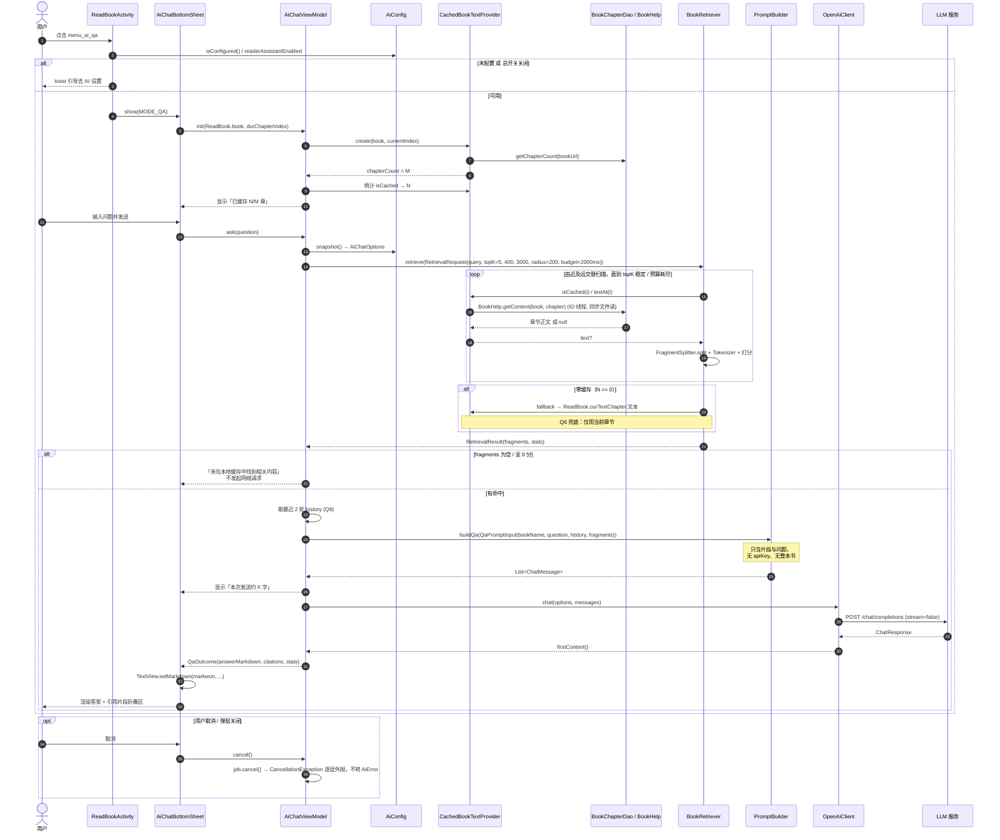
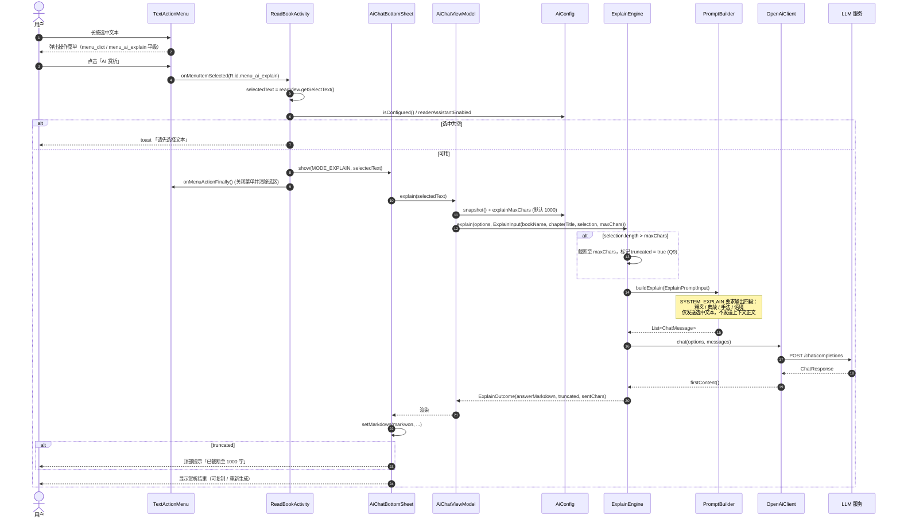
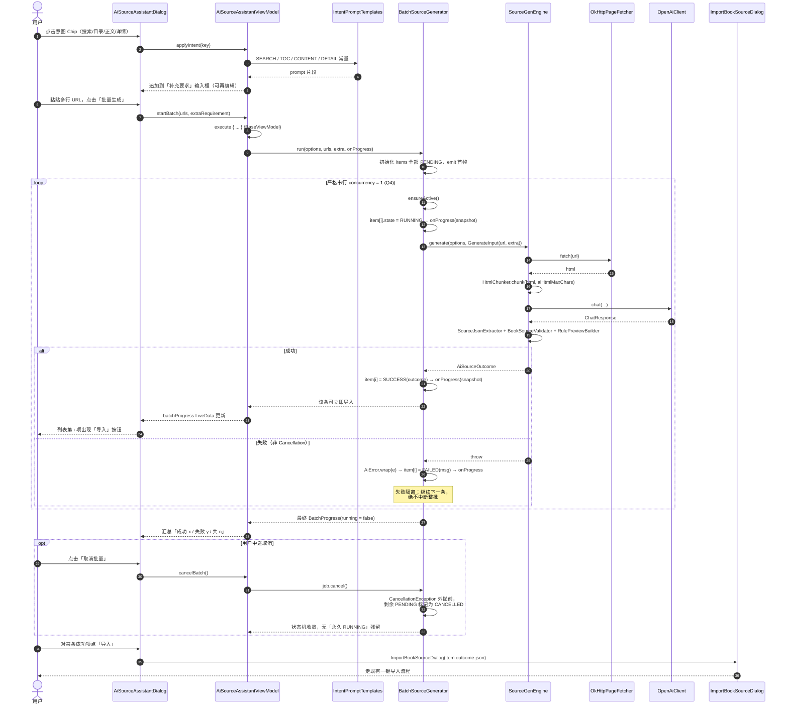
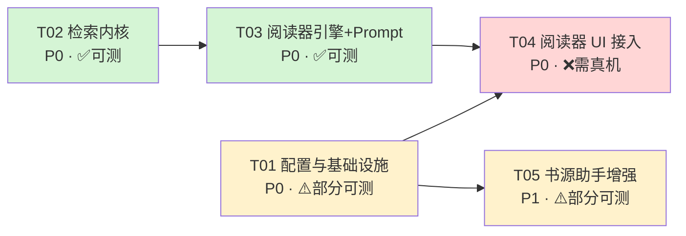

# 阅读Sigma（legado-Z）AI 能力 Phase 2 — 增量系统架构设计与任务分解

- 文档版本：v1.0
- 日期：2026-08-07
- 架构师：高见远（Gao）
- 上游输入：`docs/plans/2026-08-07-ai-phase2-prd.md`（Phase2 增量 PRD）
- 基线架构：`docs/plans/2026-08-05-ai-booksource-assistant-arch.md`（v1 架构，本文继承其 §7 Shared Knowledge）
- 适用范围：Phase2 A 块（阅读器检索问答）、B 块（划词赏析）、C 块（书源助手增强）、X 块（横切）

> **本文定位**：只做设计与分解，不含实现代码。文中出现的签名均为**接口契约**，用于约束工程师实现与 QA 用例编写。

---

## 0. 决策基线（已采纳的 Q1–Q14）

| 编号 | 决策 | 架构落点 |
|---|---|---|
| Q1 | topK=5、单片段 400 字、总量 3000 字；暴露为 `aiRetrievalTopK` / `aiRetrievalMaxChars` / `aiExplainMaxChars` | `AiConfig` + `RetrievalRequest` |
| Q2 | 不引入新依赖，自研轻量分词 | `ai/retrieval/Tokenizer.kt` |
| Q3 | 问答与赏析复用同一个 `AiChatBottomSheet`，用 `mode = QA / EXPLAIN` 区分 | `ui/ai/AiChatBottomSheet.kt` |
| Q4 | 批量生成严格串行（concurrency 恒为 1） | `BatchSourceGenerator`（无并发参数，硬编码串行） |
| Q5 | 不做模型自动下载 | 检索内核纯规则打分，无模型文件 |
| Q6 | 零缓存兜底使用"当前正在阅读的章节" | `CachedBookTextProvider` 回落 `ReadBook.curTextChapter` |
| Q7 | `menu_ai_qa` 放入 `book_read.xml`（不做悬浮球）；划词菜单只放赏析 | `res/menu/book_read.xml` + `res/menu/content_select_action.xml` |
| Q8 | 保留最近 2 轮对话 | `AiChatViewModel.history`（`ArrayDeque`，容量 2 轮 = 4 条） |
| Q9 | 赏析选中文本上限 1000 字 | `AiConfig.explainMaxChars` 默认 1000，超出**截断并提示** |
| Q10 | 意图 prompt 片段为纯 Kotlin 常量，标签文案在 `strings.xml` | `ai/prompt/IntentPromptTemplates.kt` + `ai_intent_*` 字符串 |
| Q11 | Markdown 用 markwon 渲染 | 复用 `ViewExtensions.setMarkdown` |
| Q12 | 阅读器 AI 总开关默认开 | `PreferKey.aiReaderAssistantEnabled` 默认 `true` |
| Q13 | 性能：1000+ 章"2 秒内 + 不 OOM"；默认 ±200 章窗口 / 时间预算提前返回；UI 显示"已缓存 N/M"；检索内核零 Android 依赖 | `ChapterTextProvider` 抽象 + `CachedBookTextProvider` 实现 + `RetrievalBudget` |
| Q14 | 复用 v1 单一 `AiConfig`（不新建阅读器专属配置） | `AiConfig` 追加 4 个字段 |

---

## 1. 复用映射表（v1 资产 → Phase2 用法）

> ⚠️ **重要修正**：v1 架构文档中的部分类名与仓库实际代码不一致。下表以**仓库实际代码**为准，工程师请按"实际类名"列编码。

### 1.1 内核层（`io.legado.app.ai`）

| 实际类名（仓库） | v1 文档旧称 | Phase2 用法 | 是否修改 |
|---|---|---|---|
| `ai/AiConfig.kt` | 同 | 追加 `retrievalTopK` / `retrievalMaxChars` / `explainMaxChars` / `readerAssistantEnabled`；`snapshot()` 不变（Q14 单一配置） | ✏️ 修改 |
| `ai/AiModels.kt` → `AiChatOptions` | 同 | 原样复用，A/B/C 三块共用同一份不可变快照 | ✅ 不改 |
| `ai/AiError.kt`（sealed + `wrap()`） | 同 | 原样复用；A/B 块错误一律走 `AiError.wrap()`，`CancellationException` 继续外抛 | ✅ 不改 |
| `ai/AiConfigValidator.kt` | 同 | 阅读器入口调用前先校验配置可用性 | ✅ 不改 |
| `ai/client/AiChatClient.kt` | 同 | A/B 块通过该接口调用，便于单测注入 `FakeChatClient` | ✅ 不改 |
| `ai/client/OpenAiClient.kt` | 同 | 原样复用（`okHttpClient.newBuilder()`，禁止 `new OkHttpClient()`） | ✅ 不改 |
| `ai/client/ChatModels.kt`（`ChatMessage.system/user/assistant`、`ChatResponse.firstContent()`） | 同 | A/B 块 prompt 组装与响应提取直接复用 | ✅ 不改 |
| `ai/prompt/PromptBuilder.kt`（object） | 同 | 追加 `buildQa()` / `buildExplain()`；**保持"不接收 `AiChatOptions`"的隐私签名约束** | ✏️ 修改 |
| `ai/prompt/PromptTemplates.kt` | 同 | C 块继续使用 `SYSTEM_GENERATE` / `RULE_FIELD_CHEATSHEET`；阅读器模板另置新文件避免污染 | ✅ 不改 |
| `ai/html/HtmlChunker.kt` | `HtmlSnippetExtractor` / `TokenEstimator` | C 块批量生成每条 URL 仍走 `chunk(html, maxChars)`；A 块**不使用** | ✅ 不改 |
| `ai/source/BookSourceSchema.kt` | 同 | C 块复用 | ✅ 不改 |
| `ai/source/BookSourceValidator.kt` | 同 | C 块批量每条结果独立校验 | ✅ 不改 |
| `ai/source/RulePreviewBuilder.kt` | `SourceRulePreview` | C 块批量结果卡片预览 | ✅ 不改 |
| `ai/source/SourceJsonExtractor.kt` | `AiJsonExtractor` | C 块批量结果 JSON 提取 | ✅ 不改 |
| `ai/PageFetcher.kt` / `ai/OkHttpPageFetcher.kt` | 同 | C 块批量抓取每条 URL | ✅ 不改 |
| `ai/engine/SourceGenEngine.kt` | 同 | **批量编排器内部逐条调用它**，引擎本身零改动（失败隔离在编排层） | ✅ 不改 |
| `ai/engine/OutcomeAssembler.kt` | 同 | 由 `SourceGenEngine` 内部使用 | ✅ 不改 |
| `ai/engine/SourceDebugEngine.kt` | 同 | C 块调试 Tab 不变 | ✅ 不改 |

### 1.2 UI / 宿主层

| 实际文件（仓库） | v1 文档旧称 | Phase2 用法 | 是否修改 |
|---|---|---|---|
| `ui/ai/AiSettingsDialog.kt` | `AiConfigDialog` | 追加检索/赏析/总开关 4 项设置 | ✏️ 修改 |
| `ui/ai/AiSourceAssistantDialog.kt` | `AiSourceHelperDialog` | 生成 Tab 追加"意图模板 Chip 组" + "批量 URL 区" + 批量结果列表 | ✏️ 修改 |
| `ui/ai/AiSourceAssistantViewModel.kt` | `AiSourceHelperViewModel` | 追加 `startBatch()` / `cancelBatch()` / `batchProgress` LiveData | ✏️ 修改 |
| `ui/ai/RulePreviewAdapter.kt` | 同 | 批量结果展开时复用 | ✅ 不改 |
| `ui/book/source/manage/ImportBookSourceDialog(json)` | 同 | 批量列表每条成功项"立即导入" | ✅ 不改 |
| `utils/ViewExtensions.kt#setMarkdown(markwon, spanned, ...)` | 同 | Q11：问答/赏析答案渲染唯一路径 | ✅ 不改 |
| `base/BaseViewModel#execute{}` | 同 | 所有异步入口 | ✅ 不改 |
| `help/book/BookHelp#getContent(book, chapter)` | — | A 块章节正文数据源（**同步文件读**，必须在 IO 调度器 + 预算控制下调用） | ✅ 不改 |
| `data/dao/BookChapterDao#getChapterList(bookUrl, start, end)` / `getChapterCount(bookUrl)` | — | A 块窗口化分页取章节，避免一次性全量加载 | ✅ 不改 |
| `model/ReadBook`（`book` / `durChapterIndex` / `chapterSize` / `curTextChapter`） | — | A 块上下文与 Q6 零缓存兜底 | ✅ 不改 |
| `ui/book/read/ReadBookActivity#onMenuItemSelected` | — | 追加 `menu_ai_qa` / `menu_ai_explain` 分支（紧邻 `menu_dict`） | ✏️ 修改 |
| `ui/book/read/TextActionMenu.kt` | — | 仅当"前 5 项可见"排序需要调整时改动 | ⚠️ 条件性修改 |

### 1.3 与 DictRule 的关系（PRD 明确要求）

赏析功能**不改动** `DictRule` / `DictDialog` 任何逻辑，二者在 `content_select_action.xml` 中**平级共存**：
- `menu_dict` → 词典（外部规则源，原样保留）
- `menu_ai_explain` → AI 赏析（新增，走 `AiChatBottomSheet(mode = EXPLAIN)`）

---

## 2. 框架与技术选型（新增运行时依赖 = 0）

| 关注点 | 选型 | 理由 / 拒绝的替代方案 |
|---|---|---|
| 局部检索 | **自研规则打分**（词频 + 位置衰减 + 标题加权 + 邻近度） | Q2/Q5 要求零新依赖、零模型下载。拒绝 Lucene（体积 +2MB、Android 适配成本）、拒绝 embedding 方案（需模型文件 / 需联网算 embedding，违反"整本书不出设备"红线） |
| 中文分词 | **自研 `Tokenizer`**：小写化 → 标点归一 → 英文空格切分 → 中文 bigram | 拒绝 jieba-android / HanLP（词典体积大）。bigram 对"检索召回"场景召回率足够，且**完全可 JVM 单测** |
| 片段切分 | **自研 `FragmentSplitter`**：段落优先 + 定长窗口（400 字）+ 重叠（80 字） | 重叠保证跨段落语义不被切断；定长便于满足 Q1 上限 |
| Markdown 渲染 | **Markwon 4.6.2（已在依赖中）** + `ViewExtensions.setMarkdown` | Q11 明确；项目内 `DictDialog`/`TextDialog` 已验证该路径 |
| 网络 | 复用全局 `okHttpClient.newBuilder()` | v1 §7 硬约束，禁止 `OkHttpClient()` |
| JSON | `io.legado.app.utils.GSON` | v1 §7.5 硬约束 |
| HTML 解析 | Jsoup 1.16.2（现状，**不升级**） | 仅 C 块使用 |
| 并发 | kotlinx-coroutines（已有）；`BaseViewModel.execute{}` | v1 §7.7 |
| 单测 | JUnit4 + kotlinx-coroutines-test（**已在 testImplementation 中**） | 无需新增 |
| 底部弹层 | `BottomSheetDialogFragment`（Material，已有） | Q3 单一弹层双模式 |
| 列表 | RecyclerView + 项目既有 `RecyclerAdapter` 基类 | 与 `RulePreviewAdapter` 一致 |

**架构模式**：延续 v1 的「**纯 Kotlin 内核 + Android 外壳**」双层结构。
- 内核（`io.legado.app.ai.**`，`AiConfig.kt` 除外）：零 `android.*` / `androidx.*` / `io.legado.app.data.*` 导入 → 100% JVM 可测。
- 外壳（`io.legado.app.ui.ai.**`、`io.legado.app.help.ai.**`）：负责取数、生命周期、渲染。
- **关键解耦点**：`ChapterTextProvider` 接口把"章节正文从哪来"从检索内核中剥离，使 `BookRetriever` 可以在 JVM 上用内存假数据完整测试（Q13 要求）。

---

## 3. 文件清单

### 3.1 新增文件（27 个：主代码 20 + 单测 7）

**检索内核（纯 Kotlin，零 Android）**
```
app/src/main/java/io/legado/app/ai/retrieval/RetrievalModels.kt
app/src/main/java/io/legado/app/ai/retrieval/ChapterTextProvider.kt
app/src/main/java/io/legado/app/ai/retrieval/Tokenizer.kt
app/src/main/java/io/legado/app/ai/retrieval/FragmentSplitter.kt
app/src/main/java/io/legado/app/ai/retrieval/BookRetriever.kt
```

**阅读器 AI 引擎与 Prompt（纯 Kotlin）**
```
app/src/main/java/io/legado/app/ai/AiReaderModels.kt
app/src/main/java/io/legado/app/ai/prompt/ReaderPromptTemplates.kt
app/src/main/java/io/legado/app/ai/engine/ReaderQaEngine.kt
app/src/main/java/io/legado/app/ai/engine/ExplainEngine.kt
```

**书源助手增强内核（纯 Kotlin）**
```
app/src/main/java/io/legado/app/ai/prompt/IntentPromptTemplates.kt
app/src/main/java/io/legado/app/ai/batch/BatchModels.kt
app/src/main/java/io/legado/app/ai/batch/BatchSourceGenerator.kt
```

**Android 外壳**
```
app/src/main/java/io/legado/app/help/ai/CachedBookTextProvider.kt
app/src/main/java/io/legado/app/ui/ai/AiChatBottomSheet.kt
app/src/main/java/io/legado/app/ui/ai/AiChatViewModel.kt
app/src/main/java/io/legado/app/ui/ai/AiChatAdapter.kt
app/src/main/java/io/legado/app/ui/ai/BatchTaskAdapter.kt
```

**布局**
```
app/src/main/res/layout/dialog_ai_chat.xml
app/src/main/res/layout/item_ai_chat_message.xml
app/src/main/res/layout/item_ai_batch_task.xml
```

**单测（JVM）**
```
app/src/test/java/io/legado/app/ai/retrieval/TokenizerTest.kt
app/src/test/java/io/legado/app/ai/retrieval/FragmentSplitterTest.kt
app/src/test/java/io/legado/app/ai/retrieval/BookRetrieverTest.kt
app/src/test/java/io/legado/app/ai/prompt/ReaderPromptBuilderTest.kt
app/src/test/java/io/legado/app/ai/engine/ReaderQaEngineTest.kt
app/src/test/java/io/legado/app/ai/engine/ExplainEngineTest.kt
app/src/test/java/io/legado/app/ai/batch/BatchSourceGeneratorTest.kt
```

### 3.2 修改文件（14 个，含 1 个条件性）

```
app/src/main/java/io/legado/app/constant/PreferKey.kt            # +4 key
app/src/main/java/io/legado/app/ai/AiConfig.kt                   # +4 字段读写
app/src/main/java/io/legado/app/ai/prompt/PromptBuilder.kt       # +buildQa / +buildExplain
app/src/main/java/io/legado/app/ui/ai/AiSettingsDialog.kt        # +4 设置项
app/src/main/java/io/legado/app/ui/ai/AiSourceAssistantDialog.kt # +意图 Chip / +批量区
app/src/main/java/io/legado/app/ui/ai/AiSourceAssistantViewModel.kt # +批量编排接线
app/src/main/java/io/legado/app/ui/book/read/ReadBookActivity.kt # +menu_ai_qa / +menu_ai_explain 分支
app/src/main/res/menu/book_read.xml                              # +menu_ai_qa
app/src/main/res/menu/content_select_action.xml                  # +menu_ai_explain（紧邻 menu_dict）
app/src/main/res/layout/dialog_ai_settings.xml                   # +4 设置项
app/src/main/res/layout/dialog_ai_source_assistant.xml           # +Chip 组 / +批量 URL 输入 / +批量列表
app/src/main/res/values/strings.xml                              # 全部新增文案 key
app/src/main/res/values-zh-rCN/strings.xml                       # 中文文案
app/src/main/java/io/legado/app/ui/book/read/TextActionMenu.kt   # ⚠️ 仅当需调整"前 5 项可见"顺序
```

---

## 4. 数据结构与接口（Mermaid classDiagram）

```mermaid
classDiagram
    direction LR

    %% ==================== v1 复用（不改） ====================
    class AiChatOptions {
        <<v1 reuse>>
        +String endpoint
        +String apiKey
        +String model
        +Float temperature
        +Int maxTokens
        +Int timeoutSec
    }
    class AiChatClient {
        <<v1 interface>>
        +chat(AiChatOptions, List~ChatMessage~) ChatResponse
        +ping(AiChatOptions) Boolean
    }
    class OpenAiClient {
        <<v1 reuse>>
        -OkHttpClient okHttpClient
    }
    class ChatMessage {
        <<v1 reuse>>
        +String role
        +String content
        +system(String)$ ChatMessage
        +user(String)$ ChatMessage
        +assistant(String)$ ChatMessage
    }
    class AiError {
        <<v1 sealed>>
        +String detail
        +wrap(Throwable)$ AiError
    }
    class SourceGenEngine {
        <<v1 reuse>>
        +generate(AiChatOptions, GenerateInput) AiSourceOutcome
    }
    class AiSourceOutcome {
        <<v1 reuse>>
        +String json
        +ValidationResult validation
        +List~RulePreviewItem~ previews
    }

    %% ==================== 扩展的 v1 类 ====================
    class AiConfig {
        <<v1 extended>>
        +snapshot() AiChatOptions
        +save(...)
        +isConfigured() Boolean
        +retrievalTopK Int
        +retrievalMaxChars Int
        +explainMaxChars Int
        +readerAssistantEnabled Boolean
    }
    class PromptBuilder {
        <<v1 extended>>
        +buildGenerate(GenerateInput) List~ChatMessage~
        +buildDebug(DebugInput) List~ChatMessage~
        +buildRepair(...) List~ChatMessage~
        +buildQa(QaPromptInput) List~ChatMessage~
        +buildExplain(ExplainPromptInput) List~ChatMessage~
    }
    class ReaderPromptTemplates {
        <<new object>>
        +SYSTEM_QA String$
        +SYSTEM_EXPLAIN String$
        +LABEL_FRAGMENTS String$
        +LABEL_HISTORY String$
        +LABEL_QUESTION String$
        +LABEL_SELECTION String$
        +NO_EVIDENCE_HINT String$
    }
    class IntentPromptTemplates {
        <<new object>>
        +SEARCH String$
        +TOC String$
        +CONTENT String$
        +DETAIL String$
        +all() List~IntentSnippet~$
    }

    %% ==================== 检索内核（新增，纯 Kotlin） ====================
    class ChapterTextProvider {
        <<new interface>>
        +chapterCount() Int
        +currentIndex() Int
        +titleAt(Int) String
        +isCached(Int) Boolean
        +textAt(Int) String?
    }
    class ChapterRef {
        <<new>>
        +Int index
        +String title
    }
    class TextFragment {
        <<new>>
        +Int chapterIndex
        +String chapterTitle
        +Int charStart
        +String text
    }
    class ScoredFragment {
        <<new>>
        +TextFragment fragment
        +Double score
    }
    class RetrievalRequest {
        <<new>>
        +String query
        +Int topK
        +Int maxCharsPerFragment
        +Int maxTotalChars
        +Int windowRadius
        +Long timeBudgetMs
    }
    class RetrievalStats {
        <<new>>
        +Int scannedChapters
        +Int cachedChapters
        +Int totalChapters
        +Long elapsedMs
        +Boolean budgetExceeded
        +Boolean usedFallback
    }
    class RetrievalResult {
        <<new>>
        +List~ScoredFragment~ fragments
        +RetrievalStats stats
        +Boolean isEmpty
        +Int totalChars
    }
    class Tokenizer {
        <<new object>>
        +tokenize(String) List~String~
        +normalize(String) String
    }
    class FragmentSplitter {
        <<new object>>
        +split(Int, String, String, Int, Int) List~TextFragment~
    }
    class BookRetriever {
        <<new class>>
        -ChapterTextProvider provider
        +retrieve(RetrievalRequest) RetrievalResult
        -scoreFragment(List~String~, TextFragment, Int) Double
        -selectTopK(List~ScoredFragment~, RetrievalRequest) List~ScoredFragment~
    }

    %% ==================== 阅读器引擎（新增，纯 Kotlin） ====================
    class ChatTurn {
        <<new>>
        +String question
        +String answer
    }
    class QaInput {
        <<new>>
        +String bookName
        +String question
        +List~ChatTurn~ history
        +RetrievalRequest retrieval
    }
    class QaOutcome {
        <<new>>
        +String answerMarkdown
        +List~ScoredFragment~ citations
        +RetrievalStats stats
        +Int promptChars
    }
    class ExplainInput {
        <<new>>
        +String bookName
        +String chapterTitle
        +String selection
        +Int maxChars
    }
    class ExplainOutcome {
        <<new>>
        +String answerMarkdown
        +Boolean truncated
        +Int sentChars
    }
    class QaPromptInput {
        <<new>>
        +String bookName
        +String question
        +List~ChatTurn~ history
        +List~ScoredFragment~ fragments
    }
    class ExplainPromptInput {
        <<new>>
        +String bookName
        +String chapterTitle
        +String selection
    }
    class ReaderQaEngine {
        <<new class>>
        -AiChatClient client
        -BookRetriever retriever
        +ask(AiChatOptions, QaInput) QaOutcome
    }
    class ExplainEngine {
        <<new class>>
        -AiChatClient client
        +explain(AiChatOptions, ExplainInput) ExplainOutcome
    }

    %% ==================== 批量编排（新增，纯 Kotlin） ====================
    class BatchItemState {
        <<enumeration>>
        PENDING
        RUNNING
        SUCCESS
        FAILED
        CANCELLED
    }
    class BatchItem {
        <<new>>
        +Int index
        +String url
        +BatchItemState state
        +AiSourceOutcome? outcome
        +String? errorMessage
    }
    class BatchProgress {
        <<new>>
        +List~BatchItem~ items
        +Int finished
        +Int total
        +Boolean running
        +successCount() Int
        +failedCount() Int
    }
    class BatchSourceGenerator {
        <<new class>>
        -SourceGenEngine engine
        +run(AiChatOptions, List~String~, String?, (BatchProgress)->Unit) BatchProgress
    }

    %% ==================== Android 外壳 ====================
    class CachedBookTextProvider {
        <<new android>>
        -Book book
        -List~ChapterRef~ refs
        +chapterCount() Int
        +textAt(Int) String?
        +loadWindow(Int, Int)
    }
    class AiChatBottomSheet {
        <<new android>>
        +MODE_QA Int$
        +MODE_EXPLAIN Int$
        +newInstance(Int, String?)$ AiChatBottomSheet
    }
    class AiChatViewModel {
        <<new android>>
        +LiveData~List~ChatTurn~~ turns
        +LiveData~RetrievalStats~ stats
        +ask(String)
        +explain(String)
        +cancel()
    }
    class AiChatAdapter {
        <<new android>>
    }
    class BatchTaskAdapter {
        <<new android>>
    }
    class AiSourceAssistantViewModel {
        <<v1 extended>>
        +LiveData~BatchProgress~ batchProgress
        +startBatch(List~String~, String?)
        +cancelBatch()
        +applyIntent(String)
    }
    class AiSourceAssistantDialog {
        <<v1 extended>>
    }
    class ReadBookActivity {
        <<extended>>
        +onMenuItemSelected(Int) Boolean
    }

    %% ==================== 关系 ====================
    OpenAiClient ..|> AiChatClient
    AiConfig ..> AiChatOptions : produces
    PromptBuilder ..> ReaderPromptTemplates : uses
    PromptBuilder ..> ChatMessage : builds
    PromptBuilder ..> QaPromptInput : input
    PromptBuilder ..> ExplainPromptInput : input

    BookRetriever o-- ChapterTextProvider : depends on abstraction
    BookRetriever ..> Tokenizer : uses
    BookRetriever ..> FragmentSplitter : uses
    BookRetriever ..> RetrievalRequest : input
    BookRetriever ..> RetrievalResult : output
    RetrievalResult *-- ScoredFragment
    RetrievalResult *-- RetrievalStats
    ScoredFragment *-- TextFragment

    ReaderQaEngine o-- AiChatClient
    ReaderQaEngine o-- BookRetriever
    ReaderQaEngine ..> PromptBuilder : uses
    ReaderQaEngine ..> QaInput : input
    ReaderQaEngine ..> QaOutcome : output
    ReaderQaEngine ..> AiError : throws

    ExplainEngine o-- AiChatClient
    ExplainEngine ..> PromptBuilder : uses
    ExplainEngine ..> ExplainInput : input
    ExplainEngine ..> ExplainOutcome : output

    BatchSourceGenerator o-- SourceGenEngine
    BatchSourceGenerator ..> BatchProgress : emits
    BatchProgress *-- BatchItem
    BatchItem --> BatchItemState
    BatchItem ..> AiSourceOutcome

    CachedBookTextProvider ..|> ChapterTextProvider
    CachedBookTextProvider *-- ChapterRef

    AiChatViewModel o-- ReaderQaEngine
    AiChatViewModel o-- ExplainEngine
    AiChatViewModel ..> CachedBookTextProvider : creates
    AiChatViewModel ..> AiConfig : snapshot()
    AiChatBottomSheet o-- AiChatViewModel
    AiChatBottomSheet o-- AiChatAdapter
    ReadBookActivity ..> AiChatBottomSheet : shows

    AiSourceAssistantViewModel o-- BatchSourceGenerator
    AiSourceAssistantViewModel ..> IntentPromptTemplates : uses
    AiSourceAssistantDialog o-- AiSourceAssistantViewModel
    AiSourceAssistantDialog o-- BatchTaskAdapter
```



### 4.1 关键契约说明

**`ChapterTextProvider`（检索内核唯一外部依赖）**
```
interface ChapterTextProvider {
    fun chapterCount(): Int          // 总章节数 M
    fun currentIndex(): Int          // 当前阅读章节下标（打分位置衰减基准）
    fun titleAt(index: Int): String  // 章节标题（参与标题加权）
    fun isCached(index: Int): Boolean// 是否有本地缓存（不触发磁盘读，用于统计 N/M）
    fun textAt(index: Int): String?  // 章节正文；null = 未缓存/读失败（绝不联网）
}
```
> 该接口位于 `io.legado.app.ai.retrieval`，**禁止**出现任何 Android/Room 类型。测试用 `InMemoryChapterTextProvider` 注入。

**`BookRetriever.retrieve()` 打分公式（可单测断言）**
```
score(fragment) = Σ_t [ tf(t, fragment) × idfLite(t) ]        // 词频 × 轻量逆文档频率
                + TITLE_BONUS   × titleHitRatio(fragment)      // 标题命中加权
                + PROXIMITY_BONUS × adjacentPairHits(fragment) // 查询词邻近度
                × positionDecay(|chapterIndex - currentIndex|)  // 距当前章越近权重越高
idfLite(t) = ln(1 + candidateFragmentCount / (1 + df(t)))
positionDecay(d) = 1.0 / (1.0 + DECAY_ALPHA × d)
```
所有常量（`TITLE_BONUS` / `PROXIMITY_BONUS` / `DECAY_ALPHA`）为 `internal const`，单测可直接引用断言。

**零命中判定**：`selectTopK` 后若 `fragments.isEmpty()` 或所有 `score <= 0`，返回 `RetrievalResult(fragments = emptyList())`，`ReaderQaEngine` **直接返回"未找到相关内容"且不发起任何网络请求**（隐私红线 + 省 token）。

**预算与窗口（Q13）**
```
RetrievalRequest.windowRadius  // 默认 200：只扫描 [cur-200, cur+200] 章
RetrievalRequest.timeBudgetMs  // 默认 2000：超时立即用已扫描结果返回，stats.budgetExceeded = true
```
扫描顺序为**由近及远交替**（cur, cur-1, cur+1, cur-2, cur+2 …），保证时间预算耗尽时保留的是最相关区域。

---

## 5. 程序调用流程（Mermaid sequenceDiagram）

### 5.1 阅读器检索问答（A 块，PH2-P0-1 ~ PH2-P0-4）



### 5.2 划词赏析（B 块，PH2-P0-5 ~ PH2-P0-6）



### 5.3 书源助手批量生成（C 块，PH2-P1-3 ~ PH2-P1-5）



---

## 6. 任务分解（按依赖排序）

> 说明：`可单测` 列语义 — ✅ 纯 JVM 单测可完全覆盖；⚠️ 内核部分可单测、UI 部分需真机；❌ 只能真机/模拟器验收（沙箱无法编译 Android，不得声称"已验证"）。

### T01 · 配置与基础设施（P0）

| 项 | 内容 |
|---|---|
| **依赖** | 无 |
| **PRD 需求** | PH2-P0-9（AI 设置扩展）、PH2-P1-6（总开关）、X 块 Q1/Q9/Q12/Q14 |
| **可单测** | ⚠️（`AiConfig` 默认值/边界钳制逻辑可抽为纯函数单测；SharedPreferences 读写需真机） |
| **文件** | `constant/PreferKey.kt`(M)、`ai/AiConfig.kt`(M)、`ui/ai/AiSettingsDialog.kt`(M)、`res/layout/dialog_ai_settings.xml`(M)、`res/values/strings.xml`(M)、`res/values-zh-rCN/strings.xml`(M) |

**要点**
1. `PreferKey` 新增 4 个常量：`aiRetrievalTopK` / `aiRetrievalMaxChars` / `aiExplainMaxChars` / `aiReaderAssistantEnabled`。
2. `AiConfig` 追加对应 getter/setter，默认值：`5` / `400` / `1000` / `true`（Q1/Q9/Q12）。读取时做**范围钳制**（topK ∈ [1,10]，maxChars ∈ [100,1000]，explainMaxChars ∈ [200,2000]），钳制函数抽为 `internal fun clamp(...)` 便于单测。
3. `snapshot()` 返回的 `AiChatOptions` **保持 v1 结构不变**（Q14：检索参数不进入网络请求参数体）。
4. `AiSettingsDialog` 追加：总开关 Switch + 3 个数值输入；文案 key 统一 `ai_` 前缀。
5. 一次性把 Phase2 **全部**新增文案 key 写入两份 `strings.xml`（含 `menu_ai_qa` / `menu_ai_explain` / `ai_intent_*` / 批量状态文案），避免后续任务反复改同一文件产生冲突。

---

### T02 · 检索内核（纯 Kotlin，零 Android 依赖）（P0）

| 项 | 内容 |
|---|---|
| **依赖** | 无（可与 T01 并行） |
| **PRD 需求** | PH2-P0-2（本地检索召回）、PH2-P0-3（topK 片段）、PH2-P2-1（性能基线）、Q1/Q2/Q13 |
| **可单测** | ✅ 全覆盖 |
| **文件** | 新增 `ai/retrieval/RetrievalModels.kt`、`ChapterTextProvider.kt`、`Tokenizer.kt`、`FragmentSplitter.kt`、`BookRetriever.kt`；单测 `TokenizerTest.kt`、`FragmentSplitterTest.kt`、`BookRetrieverTest.kt` |

**要点**
1. `ChapterTextProvider` 为唯一外部依赖抽象；**严禁**在本包出现 `android.*` / `androidx.*` / `io.legado.app.data.*`。
2. `Tokenizer`：`normalize()`（小写 + 全角半角归一 + 标点转空格）→ 英文按空白切分 → 连续 CJK 生成 bigram。空查询返回 `emptyList()`。
3. `FragmentSplitter.split(chapterIndex, title, text, maxChars = 400, overlap = 80)`：段落优先合并，单段超长时定长切分并保留 `charStart`。
4. `BookRetriever.retrieve()`：按 §4.1 公式打分；实现"由近及远交替扫描 + `windowRadius` + `timeBudgetMs` 提前返回"；返回 `RetrievalStats(scanned, cached, total, elapsedMs, budgetExceeded, usedFallback)`。
5. 总字数裁剪：按分数降序累加，超过 `maxTotalChars(3000)` 即停止追加（**不做片段内二次截断**，保证语义完整）。
6. 每轮章节循环调用 `coroutineContext.ensureActive()`；`CancellationException` 不捕获。

**单测清单（供 QA 直接复用）**
- 空查询 / 纯标点查询 → 零命中，不抛异常
- 中英混合查询的 bigram 切分正确性
- 命中片段数 ≤ topK；单片段 ≤ 400 字；总字数 ≤ 3000
- 当前章节命中优先于远距离章节（位置衰减生效）
- 标题命中的片段分数高于同词频的正文片段
- `timeBudgetMs = 0` → 立即返回且 `budgetExceeded = true`
- 1000 章内存假数据（每章 3000 字）retrieve 在 JVM 上 < 2s 且无 OOM（Q13 基线的 JVM 侧代理指标）
- 所有章节 `textAt` 返回 null → `RetrievalResult` 为空且 `cachedChapters = 0`

---

### T03 · 阅读器 AI 引擎与 Prompt（纯 Kotlin）（P0）

| 项 | 内容 |
|---|---|
| **依赖** | T02 |
| **PRD 需求** | PH2-P0-3、PH2-P0-4（问答生成）、PH2-P0-5、PH2-P0-6（赏析）、PH2-P0-8（隐私）、Q8/Q9 |
| **可单测** | ✅ 全覆盖（注入 `FakeChatClient`） |
| **文件** | 新增 `ai/AiReaderModels.kt`、`ai/prompt/ReaderPromptTemplates.kt`、`ai/engine/ReaderQaEngine.kt`、`ai/engine/ExplainEngine.kt`；修改 `ai/prompt/PromptBuilder.kt`；单测 `ReaderPromptBuilderTest.kt`、`ReaderQaEngineTest.kt`、`ExplainEngineTest.kt` |

**要点**
1. `PromptBuilder.buildQa(QaPromptInput)` / `buildExplain(ExplainPromptInput)`：**签名中不得出现 `AiChatOptions`**（v1 §7.6 隐私红线，签名级保证 apiKey 不可能进入 prompt）。
2. `SYSTEM_QA` 约束：只依据【资料片段】回答；资料不足时明确说明"本地缓存中未找到依据"；输出 Markdown；不得编造章节号。
3. `SYSTEM_EXPLAIN` 约束：固定四段 Markdown 小标题 —— 释义 / 典故 / 手法 / 语境；无典故时写"无"，不得留空段。
4. `ReaderQaEngine.ask()`：`retriever.retrieve()` → 零命中**直接短路返回**（不调用 `client.chat`）→ 有命中才组 prompt 调用；异常统一 `AiError.wrap()`，`CancellationException` 外抛。
5. `ExplainEngine.explain()`：超长截断 + `truncated` 标记（Q9）；`sentChars` 供 UI 展示"本次发送 X 字"。
6. 历史轮次由调用方（ViewModel）裁剪为最近 2 轮传入（Q8）；`PromptBuilder` 对超过 2 轮的输入**再做一次防御性裁剪**。

**单测清单**
- 零命中 → `FakeChatClient.callCount == 0`（隐私 + 省 token 双重断言）
- prompt 全文不包含 apiKey / endpoint 任意子串
- prompt 全文不包含未被召回的章节正文
- 赏析 prompt 只含选中文本，不含书籍其他正文
- 选中 1500 字 → `sentChars == 1000` 且 `truncated == true`
- 传入 5 轮历史 → prompt 中只出现最近 2 轮
- `FakeChatClient` 抛 `IOException` → 得到 `AiError` 子类且 `detail` 不含密钥
- `FakeChatClient` 抛 `CancellationException` → 原样外抛，不被 `wrap()` 吞掉

---

### T04 · 阅读器 UI 接入（A + B 块外壳）（P0）

| 项 | 内容 |
|---|---|
| **依赖** | T01、T03 |
| **PRD 需求** | PH2-P0-1（入口）、PH2-P0-5（划词入口）、PH2-P0-7（Markdown 渲染）、PH2-P1-1（缓存进度展示）、PH2-P1-2（发送量预览）、Q3/Q6/Q7/Q11/Q12 |
| **可单测** | ❌（需真机/模拟器验收） |
| **文件** | 新增 `help/ai/CachedBookTextProvider.kt`、`ui/ai/AiChatBottomSheet.kt`、`ui/ai/AiChatViewModel.kt`、`ui/ai/AiChatAdapter.kt`、`res/layout/dialog_ai_chat.xml`、`res/layout/item_ai_chat_message.xml`；修改 `res/menu/book_read.xml`、`res/menu/content_select_action.xml`、`ui/book/read/ReadBookActivity.kt`、（条件性）`ui/book/read/TextActionMenu.kt` |

**要点**
1. `CachedBookTextProvider`（放在 `io.legado.app.help.ai`，**不得**放进 `io.legado.app.ai`）：
   - 构造时用 `appDb.bookChapterDao.getChapterCount(bookUrl)` 拿 M；
   - `loadWindow(center, radius)` 用 `getChapterList(bookUrl, start, end)` 分段取 `BookChapter`；
   - `textAt(i)` 调 `BookHelp.getContent(book, chapter)`（**同步文件读，必须整体在 `Dispatchers.IO`**），结果做 LRU 内存缓存（上限按字符数，如 2MB），防 OOM；
   - 全部未缓存时（Q6）回落 `ReadBook.curTextChapter` 的页面文本拼接，`usedFallback = true`。
2. `AiChatBottomSheet`（Q3 单弹层双模式）：`newInstance(mode, payload)`；`MODE_QA` 显示输入框 + 历史列表 + "已缓存 N/M"；`MODE_EXPLAIN` 直接展示赏析结果 + 重新生成。
3. Markdown 渲染统一走 `TextView.setMarkdown(markwon, spanned, imgOnLongClick)`（Q11），禁止自写解析。
4. `book_read.xml` 新增 `menu_ai_qa`（Q7，不做悬浮球）；`content_select_action.xml` 在 `menu_dict` **之后紧邻**新增 `menu_ai_explain`。若因 `TextActionMenu` 的"前 5 项可见"策略导致赏析被折叠进"更多"，才调整顺序（QA 需真机确认后再决定是否改）。
5. `ReadBookActivity.onMenuItemSelected` 在 `R.id.menu_dict` 分支旁新增 `R.id.menu_ai_explain` 分支，取 `binding.readView.getSelectText()`，空则 toast 返回；随后照常 `onMenuActionFinally()`。
6. 总开关关闭（Q12 默认开）时，两个菜单项 `isVisible = false`。
7. 所有异步走 `BaseViewModel.execute{}`；弹层 `onDestroyView` 触发 `cancel()`。

**真机验收要点（交 QA）**
- 1000+ 章大书首次打开问答弹层不卡顿、无 ANR、无 OOM
- "已缓存 N/M" 数值与实际缓存章节数一致
- 零缓存书籍 → 提示"仅检索当前章节"并能正常回答
- 划词赏析与词典互不干扰
- 旋转屏幕 / 后台切换后弹层状态不崩溃
- 取消后无残留 loading

---

### T05 · 书源助手增强（C 块：意图模板 + 批量生成）（P1）

| 项 | 内容 |
|---|---|
| **依赖** | T01 |
| **PRD 需求** | PH2-P1-3（意图模板）、PH2-P1-4（批量串行）、PH2-P1-5（逐条导入 + 失败隔离）、PH2-P2-4~6、Q4/Q10 |
| **可单测** | ⚠️（`BatchSourceGenerator` + `IntentPromptTemplates` ✅ 纯 JVM 可测；Dialog/Adapter ❌ 需真机） |
| **文件** | 新增 `ai/prompt/IntentPromptTemplates.kt`、`ai/batch/BatchModels.kt`、`ai/batch/BatchSourceGenerator.kt`、`ui/ai/BatchTaskAdapter.kt`、`res/layout/item_ai_batch_task.xml`、单测 `BatchSourceGeneratorTest.kt`；修改 `ui/ai/AiSourceAssistantDialog.kt`、`ui/ai/AiSourceAssistantViewModel.kt`、`res/layout/dialog_ai_source_assistant.xml` |

**要点**
1. `IntentPromptTemplates`：4 个 `const val`（SEARCH / TOC / CONTENT / DETAIL）为纯 Kotlin 字符串片段（Q10）；Chip 上的**显示标签**来自 `strings.xml` 的 `ai_intent_*`，二者通过 `IntentSnippet(key, snippet)` 关联，**key 不进 strings.xml**。
2. `BatchSourceGenerator` 构造只接 `SourceGenEngine`，**无并发度参数**（Q4 硬串行，从签名上杜绝误配）。
3. 状态机严格收敛：`PENDING → RUNNING → SUCCESS | FAILED`；取消时剩余 `PENDING` 一律置 `CANCELLED`，当前 `RUNNING` 也置 `CANCELLED` 后再外抛 `CancellationException` —— **不允许任何 item 停留在 RUNNING**。
4. 每条失败仅 `AiError.wrap(e).let { item.errorMessage = it.detail }`，继续下一条（失败隔离）；`detail` 不得含密钥。
5. `onProgress` 回调传**不可变快照**（`BatchProgress` 及 `items` 为只读 `List`），UI 侧可安全 diff 刷新。
6. UI：URL 多行输入按换行切分 + 去空白 + 去重 + 简单 scheme 校验；每条成功项显示"导入"按钮 → `ImportBookSourceDialog(json)`；失败项显示错误摘要 + "重试本条"。
7. 建议对批量条数设上限（默认 20）并给出提示 —— 见 §9 开放项 A3。

**单测清单**
- 3 条 URL 全成功 → 严格串行（记录调用时序，无重叠）、`finished == 3`
- 第 2 条抛异常 → 第 1/3 条仍 SUCCESS，第 2 条 FAILED，整批 `running == false`
- 取消在第 2 条执行中 → 第 3 条为 CANCELLED，无 item 处于 RUNNING，`CancellationException` 外抛
- `onProgress` 每次状态变更都被调用，且快照互不共享引用
- 空 URL 列表 → 直接返回 `total = 0`，不调用引擎
- 错误信息不含 apiKey

---

### 6.1 实施顺序与并行建议

```
第 1 轮（可并行）：T01 ┃ T02
第 2 轮：T03（依赖 T02）
第 3 轮（可并行）：T04（依赖 T01+T03）┃ T05（依赖 T01）
```

**总计：5 个任务；纯 JVM 可完整单测 2 个（T02、T03）、部分可单测 2 个（T01、T05）、纯真机验收 1 个（T04）。**
**新增文件 27（主代码 20 + 单测 7），修改文件 14（含 1 个条件性）。**

### 6.2 任务依赖图



---

## 7. 依赖清单

### 7.1 新增运行时依赖：**0 个**

Phase2 不引入任何新的 `implementation` 依赖。

### 7.2 复用的既有依赖

| 依赖 | 版本 | 用途 |
|---|---|---|
| `io.noties.markwon:core` | 4.6.2（现有，**不升级**） | Q11 答案 Markdown 渲染（经 `ViewExtensions.setMarkdown`） |
| `com.squareup.okhttp3:okhttp` | 现有 | 复用全局 `okHttpClient.newBuilder()`；**禁止** `OkHttpClient()` |
| `org.jsoup:jsoup` | 1.16.2（**不升级**） | 仅 C 块 `HtmlChunker` 间接使用 |
| `com.google.code.gson` | 现有（经 `io.legado.app.utils.GSON`） | C 块书源 JSON |
| `org.jetbrains.kotlinx:kotlinx-coroutines-android` | 现有 | 全部异步 |
| Material Components | 现有 | `BottomSheetDialogFragment` / `ChipGroup` |
| AndroidX Room（`BookChapterDao`） | 现有 | 章节列表分段查询 |

### 7.3 复用的测试依赖（`testImplementation`，无新增）

| 依赖 | 用途 |
|---|---|
| `junit:junit` | 全部单测 |
| `org.jetbrains.kotlinx:kotlinx-coroutines-test` | `runTest` 驱动 `ReaderQaEngine` / `BatchSourceGenerator` 挂起函数测试与取消语义验证 |

> **不引入** MockK / Mockito：内核层全部通过手写 `FakeChatClient` / `InMemoryChapterTextProvider` / `FakeSourceGenEngine` 注入，保持与 v1 测试风格一致。

---

## 8. Shared Knowledge（继承 v1 §7，Phase2 增补）

> 以下 8.1–8.4 为 **v1 §7 原样继承，仍是硬约束**；8.5–8.12 为 Phase2 新增。

### 8.1（继承 v1 §7.1）分层红线
`io.legado.app.ai.**` 包内除 `AiConfig.kt` 外，**禁止** `import android.*` / `import androidx.*` / `import io.legado.app.data.*`。Phase2 新增的 `ai/retrieval/**`、`ai/engine/**`、`ai/batch/**`、`ai/prompt/**` 同样受此约束。凡需要 Room / BookHelp / Context 的代码，一律放 `io.legado.app.help.ai.**` 或 `io.legado.app.ui.ai.**`。

### 8.2（继承 v1 §7.3）异常规范
所有引擎层异常统一 `AiError.wrap(e)`；**`CancellationException` 必须原样 rethrow**，不得被 `catch (e: Exception)` 吞掉。挂起循环中定期 `ensureActive()`。

### 8.3（继承 v1 §7.5）JSON 规范
仅使用 `io.legado.app.utils.GSON` 及 `JsonObject`，不新建 Gson 实例、不引入其他 JSON 库。

### 8.4（继承 v1 §7.6）隐私红线
- `PromptBuilder` 任何方法签名**不得**包含 `AiChatOptions`。
- 日志中的密钥一律 `maskedKey`。
- `AiError.detail` 不得包含 endpoint 完整 URL 中的密钥参数或 apiKey。

### 8.5 检索隐私红线（Phase2 新增）
- **整本书正文永不出设备**：仅 `RetrievalResult.fragments` 中被选中的片段可进入 prompt。
- **零命中不发网络请求**：`fragments` 为空时 `ReaderQaEngine` 必须短路返回，`AiChatClient.chat` 调用次数为 0。
- **赏析仅发送选中文本**：`ExplainEngine` 不得读取或附带上下文正文、书籍简介、目录。
- 每次请求前 UI 必须能展示"本次发送约 X 字"（`QaOutcome.promptChars` / `ExplainOutcome.sentChars`）。

### 8.6 数值参数与默认值（Phase2 新增）

| 参数 | PreferKey | 默认 | 合法区间 | 来源 |
|---|---|---|---|---|
| topK | `aiRetrievalTopK` | 5 | [1, 10] | Q1 |
| 单片段字数 | `aiRetrievalMaxChars` | 400 | [100, 1000] | Q1 |
| 单次总字数 | （常量，不暴露） | 3000 | — | Q1 |
| 赏析选中上限 | `aiExplainMaxChars` | 1000 | [200, 2000] | Q9 |
| 阅读器总开关 | `aiReaderAssistantEnabled` | true | — | Q12 |
| 章节窗口半径 | （常量，不暴露） | 200 | — | Q13 |
| 检索时间预算 | （常量，不暴露） | 2000 ms | — | Q13 |
| 对话历史轮数 | （常量，不暴露） | 2 | — | Q8 |
| 批量并发度 | （硬编码） | 1 | 恒为 1 | Q4 |

所有"不暴露"常量必须是 `internal const val`，位于对应内核文件顶部，供单测直接引用。

### 8.7 命名规范（继承 v1 §7.8 + 扩展）
- 菜单 id：`menu_ai_qa`、`menu_ai_explain`
- 字符串 key：`ai_` 前缀（如 `ai_qa_title`、`ai_explain_title`、`ai_intent_search`、`ai_batch_running`）
- 布局：`dialog_ai_*`、`item_ai_*`
- 单测目录：`app/src/test/java/io/legado/app/ai/**`，与被测包路径一一对应

### 8.8 协程与生命周期
- 所有 ViewModel 异步入口使用 `BaseViewModel.execute{}`；
- 磁盘 IO（`BookHelp.getContent`）必须在 `Dispatchers.IO`；
- 弹层 `onDestroyView` 必须取消进行中的 Job；
- 引擎层挂起函数不得自行切换调度器（由调用方决定），但可在 CPU 密集打分处使用 `yield()` 让出。

### 8.9 UI 复用
- Markdown 渲染唯一入口：`TextView.setMarkdown(markwon, spanned, imgOnLongClickListener)`；
- 书源一键导入唯一入口：`ImportBookSourceDialog(json)`；
- 规则预览复用 `RulePreviewAdapter` + `RulePreviewBuilder`。

### 8.10 状态机不变式（批量）
任意时刻 `BatchProgress.items` 中处于 `RUNNING` 的数量 ≤ 1；批量结束（`running == false`）后，`RUNNING` 数量必须为 0。此不变式必须有单测断言。

### 8.11 与 DictRule 的边界
Phase2 **不修改** `DictRule`、`DictDialog`、词典规则数据结构与任何相关逻辑。赏析是并列的新增能力。

### 8.12 沙箱与验收边界
沙箱环境无法编译 Android 工程。工程师提交时须明确区分：
- **已在 JVM 单测中验证**（T02、T03，以及 T05 内核部分、T01 钳制函数）
- **仅静态检查，待真机验收**（T04 全部、T05 UI 部分、T01 SharedPreferences 部分）

不得对未经真机运行的功能声称"已验证通过"。

---

## 9. 开放项 / 仍需确认

### 9.1 PRD 待确认编号

| 编号 | 状态 | 说明 |
|---|---|---|
| **Q13** | ⚠️ **部分待定** | "1000+ 章 2 秒内 + 不 OOM"已作为设计目标，但 `windowRadius = 200` / `timeBudgetMs = 2000` / LRU 上限 2MB 三个默认值**必须在真机大书上实测后回填**。当前值为工程估算，T04 真机验收后需回写本文档。 |
| **Q15** | ❌ **未决策** | 主理人下发的决策清单覆盖 Q1–Q14，**Q15 未给出结论**。本设计暂未为其预留落点，请 PM/用户明确 Q15 内容与取舍后再评估是否影响 T04/T05 范围。 |

### 9.2 架构侧新提出的待确认项

| 编号 | 问题 | 建议默认 | 影响 |
|---|---|---|---|
| **A1** | 检索窗口 `±200 章` 之外的章节完全不参与召回，用户若问"第 1 章的伏笔"（当前读到第 800 章）会检索不到 | 建议：UI 提供"扩大检索范围（全书）"二次操作，默认仍走窗口 | T02 增加一个 `windowRadius = Int.MAX_VALUE` 分支；T04 增加一个按钮 |
| **A2** | Q8（保留 2 轮历史）与 Q1（总量 3000 字）可能冲突：历史 + 片段可能超出 `maxTokens` | 建议：**片段优先**，历史在超预算时从最旧一轮开始丢弃 | T03 `PromptBuilder.buildQa` 增加预算裁剪逻辑（本设计已按此实现） |
| **A3** | 批量生成条数是否设上限 | 建议默认上限 20 条，超出时提示分批 | T05 UI 校验 |
| **A4** | Q9 超长选中的处理方式：截断 vs 拒绝 | 本设计采用**截断 + 顶部提示**（更友好）。若 PM 要求"拒绝并提示重选"，需改 `ExplainEngine` 返回值语义 | T03 单测预期需相应调整 |
| **A5** | 赏析结果是否需要落库/收藏 | 本期不做，仅支持复制 | 若需要，需新增 Room 实体，超出 Phase2 范围 |

### 9.3 已澄清的既有事实（供工程师避坑）

1. **v1 文档类名与实际代码不一致**：实际存在的是 `HtmlChunker`（非 `HtmlSnippetExtractor`/`TokenEstimator`）、`SourceJsonExtractor`（非 `AiJsonExtractor`）、`RulePreviewBuilder`（非 `SourceRulePreview`）、`AiSourceAssistantDialog`/`AiSourceAssistantViewModel`（非 `AiSourceHelperDialog`/`ViewModel`）、`AiSettingsDialog`（非 `AiConfigDialog`）。**一律以实际代码为准。**
2. `BookHelp.getContent(book, chapter)` 是**同步**文件读取，返回 `String?`（空/缺失返回 null），本地书走 `LocalBook.getContent`。绝不会触发网络下载（符合 Q5"不做自动下载"）。
3. `BookChapterDao` 提供 `getChapterList(bookUrl, start, end)` 与 `getChapterCount(bookUrl)`，是实现窗口化检索的关键 API。
4. `TextActionMenu` 只有**前 5 项**直接可见，其余进入"更多"。新增 `menu_ai_explain` 后是否可见需真机确认。
5. `ReadBookActivity.onMenuItemSelected` 中 `R.id.menu_dict -> showDialogFragment(DictDialog(selectedText))` 是新增赏析分支的参照位置。
6. `ReadBook.curTextChapter` 持有当前章节的内存文本，是 Q6 零缓存兜底的数据来源（无需读盘）。

---

## 附：产物清单

- 本文：`docs/plans/2026-08-07-ai-phase2-arch.md`
- 类图：`docs/plans/2026-08-07-ai-phase2-class-diagram.mermaid`
- 时序图：`docs/plans/2026-08-07-ai-phase2-sequence-diagram.mermaid`
