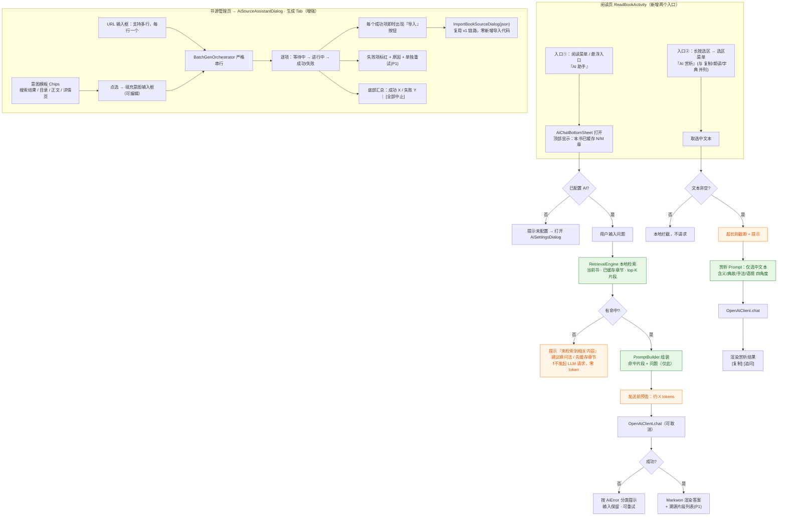

# AI 能力第二阶段（phase2）— 增量简单 PRD

> **实施范围变更（2026-08-20）**：阅读器 AI 已收敛为“仅选中片段问答/赏析 + 存为本书札记”。检索问答、章节扫描、扩大到全书等 A 块需求不再属于当前产品范围；本文相关章节仅作历史记录。书源助手需求不受影响。

> 文档类型：**增量 PRD（Delta PRD）** —— 只描述相对 v1 的**变更部分**，v1 已定义的内容不重复
> 产品线：阅读Sigma（legado-Z）Android 主工程
> 产出角色：产品经理 许清楚（Xu）
> 日期：2026-08-07
> 需求基线（必须先读）：
> - v1 PRD：`docs/plans/2026-08-05-ai-booksource-assistant-prd.md`
> - v1 架构：`docs/plans/2026-08-05-ai-booksource-assistant-arch.md`

---

## 0. 增量说明（Delta 摘要）

| 维度 | v1 现状（基线，不重复定义） | phase2 变更 |
|------|---------------------------|------------|
| 用户对象 | **书源创作者**（生成/调试书源） | **+ 普通读者**（检索问答、选中赏析）；书源创作者能力增强 |
| 使用场景 | 书源管理页 | **+ 阅读页**（底部弹窗、长按选区） |
| AI 基础设施 | `AiConfig` / `OpenAiClient` / `PromptBuilder` / `AiError` / `HtmlChunker` / `SourceGenEngine` / `SourceDebugEngine` | **100% 复用，零重写**；新增 3 类纯逻辑组件：检索引擎、赏析引擎、批量编排 |
| 数据来源 | 网页 HTML 片段 | **+ 本地已缓存章节文本**（`BookHelp.getContent` 语义，具体形态由架构师确认） |
| 隐私红线 | 只发 HTML 片段 + 意图，不发正文 | **收紧升级**：正文相关场景**只发本地检索命中的片段 / 用户选中的文本**，**全书文本永不外传** |
| 入口 | 书源管理页菜单 + 设置-其他 | **+ 阅读页 AI 入口 + 长按选区菜单项** |

**phase2 明确不做（留后续）**：全书向量 RAG、人物/剧情图谱、AI 听书旁白、跨书检索、AI 自动改写/续写。

---

## 1. 项目信息（Delta）

| 项目 | 内容 |
|------|------|
| Language | 中文 |
| Programming Language | Kotlin（Android），同 v1 |
| Project Name | `ai_reader_assistant_phase2` |
| 新增能力包（建议，最终以架构师为准） | `io.legado.app.ai.retrieval`（检索）、`io.legado.app.ai.reader`（赏析/问答编排）、`io.legado.app.ai.batch`（批量编排）；UI 在 `io.legado.app.ui.ai` 下扩展 |
| 原始需求复述 | 在 v1「AI 书源生成/调试助手」已落地的基础上，phase2 交付两块：**① 读者向 AI**（阅读页轻量 RAG 检索问答 + 长按选区 AI 赏析/解释）；**② 书源助手增强**（意图模板 + 多 URL 批量生成，逐个生成逐个导入）。全部复用现有 `io.legado.app.ai` 基础设施，不新增运营成本、不突破隐私红线。 |

---

## 2. 产品定义（Delta）

### 2.1 Product Goals（phase2 的 3 个正交目标）

| # | 目标 | 面向 | 正交性说明 |
|---|------|------|-----------|
| **G4** | **降低长篇回顾成本** —— 读者可用自然语言就"已读内容"提问，App 本地检索命中片段后由 AI 作答 | 读者 · **跨章节 / 全书维度** | 解决"读到 500 章忘了前情"，作用域是**书**；与 G5 的作用域（段落）不重叠 |
| **G5** | **提供语境级文本理解** —— 读者对选中段落获得含义 / 典故 / 写作手法 / 语境的解读 | 读者 · **当前选区维度** | 定位为现有 `DictRule`（离线字面释义）的**互补而非替代**；作用域是**一段文字** |
| **G6** | **提升书源创作产能** —— 用意图模板降低"怎么描述"的门槛，用批量生成消除"一个个来"的重复劳动 | 创作者 · **效率维度** | 不改变 v1 的生成质量目标（v1 G1/G2），只改变**单位时间产出量与输入成本**，与 G4/G5 面向人群完全不同 |

> 横切约束（继承 v1 G3，phase2 收紧）：**零成本、零厂商绑定** + **全书文本永不外传**（只发命中片段 / 选中文本）。

### 2.2 User Stories（phase2 新增场景）

- **US4（长篇读者 · G4）**：As a 在读 500+ 章长篇、隔了两周才回来的读者，I want 在阅读页直接问"主角现在的目标是什么""前面那把剑第一次出现在哪"，so that 不必手动回翻章节列表或去搜索引擎剧透。
- **US5（难文本读者 · G5）**：As a 读到用典密集 / 半文言 / 意象晦涩段落的读者，I want 长按选中这段文字后让 AI 解释它的含义、典故出处与写作手法，so that 不必跳出 App 搜索——现有字典只能给我逐字释义，给不了语境理解。
- **US6（书源作者 · G6）**：As a 需要一次性给多个站点建源的书源维护者，I want 点选「抓搜索结果 / 抓目录 / 抓正文 / 抓详情页」的意图模板，并一次粘贴多个 URL 排队生成、生成一个就能立刻导入一个，so that 不必反复输入相似描述、不必反复开关对话框。
- **US7（隐私 / 成本敏感用户 · 横切）**：As a 不愿把整本书上传到任何云端的用户，I want 明确知道"只有检索命中的少量片段 / 我选中的这段文字"被发送，并能看到本次大致发送量，so that 我能放心开启读者向 AI 能力。

---

## 3. 技术规范（Delta）

### 3.1 Requirements Pool（phase2 需求池）

**图例**：✅ = 可写 JVM 单测并在沙箱/本机跑（纯 Kotlin，零 Android API）；❌ = 需本机构建验证（UI / 入口 / Android 存储）；⚠️ = 逻辑部分可单测、载体需本机验证。
**模块**：`A` = 检索问答 · `B` = 选中赏析 · `C` = 书源助手增强 · `X` = 横切。

#### P0 — 必备（Must have）

| ID | 模块 | 需求 | 验收标准 | 单测 |
|----|------|------|---------|------|
| **PH2-P0-1** | A | **本地检索引擎（RetrievalEngine）**：输入「章节文本集合 + 用户查询」，输出 top-K 命中片段（含所属章节标识、片段文本、命中得分） | ① 给定 3 章文本 + 查询「主角的剑」，返回的片段必须包含出现该关键词的章节；② 结果按得分降序、数量 ≤ K；③ 空章节集合 / 空查询 → 返回空列表且不抛异常；④ 单片段长度 ≤ 配置上限，片段在原文中连续（不跨章拼接）；⑤ 总输出字符数 ≤ 配置上限（超出则丢弃低分片段） | ✅ |
| **PH2-P0-2** | A | **阅读页 AI 问答底部弹窗**：阅读页可调出弹窗，输入自然语言问题 → 触发检索 → 调 LLM → 渲染答案；含加载态与取消 | ① 阅读页有明确入口可打开弹窗（位置见 §3.3 Q7）；② 弹窗知道"当前是哪本书"；③ 请求中可取消，取消后 UI 回到可输入态；④ 弹窗关闭再打开不崩溃、不残留上一次加载态 | ❌ |
| **PH2-P0-3** | A | **问答 Prompt 组装**：只用「命中片段 + 用户问题（+ 书名/当前章节位置等极少元信息）」组装 messages | ① 断言 prompt **不包含** apiKey；② 断言 prompt **不包含**未命中的章节文本；③ 片段在 prompt 中带来源标注（章节名/序号）以便模型引用；④ system 提示词明确"仅依据给定片段作答，信息不足时如实说明"；⑤ 全部 prompt 文本写在模板常量文件中（沿用 v1 §7.4 约定） | ✅ |
| **PH2-P0-4** | A | **问答全链路降级不崩**：覆盖 6 种失败态 —— ①未配置 AI ②该书无任何已缓存章节 ③检索零命中 ④LLM 超时 ⑤401/429/5xx ⑥空回复 | ① 每种失败态有独立、可读的中文提示（非异常堆栈）；② 用户输入的问题保留、可重试；③ 「检索零命中」必须与「LLM 失败」文案区分开（前者建议用户换问法或先缓存章节）；④ 无未捕获异常 | ⚠️（分支逻辑 ✅ / 文案与 UI ❌） |
| **PH2-P0-5** | B | **长按选区「AI 赏析」入口**：阅读页长按选区菜单新增一项，与现有 `menu_copy` / `menu_dict` 等并列 | ① 选区菜单出现「AI 赏析」项；② 点击后携带**当前选中文本**打开赏析界面；③ 未配置 AI 时提示去配置而非静默失败；④ **不改变、不移除**现有 `menu_dict` 行为（互补定位） | ❌ |
| **PH2-P0-6** | B | **赏析引擎 + Prompt 组装**：仅以选中文本（+ 可选书名/章节名）为输入，产出含义 / 典故出处 / 写作手法 / 语境四个角度的解读 | ① 断言 prompt **只含**选中文本，不含其它章节正文、不含 apiKey；② 选中文本超过长度上限时按上限截断并在 UI 明确提示"已截断"；③ 选中文本为空/纯空白 → 直接本地拦截，不发起请求；④ 输出结构稳定（四个角度以小标题呈现，允许模型对不适用角度说明"无"） | ✅ |
| **PH2-P0-7** | C | **意图模板（数据 + 点选填充）**：生成 Tab 提供预置模板，至少覆盖「抓搜索结果列表」「抓目录/章节列表」「抓正文」「抓书籍详情页」四类 | ① 模板集合非空且四类全覆盖，每项含 `key`（稳定标识）+ 展示名 + prompt 片段；② `key` 全局唯一、无重复；③ 点选后**填充到意图输入框且可继续编辑**（不是只读锁定）；④ 多选时片段以确定顺序拼接、不产生重复文本；⑤ 模板为纯数据，不引入新的分支逻辑 | ⚠️（模板数据与拼接 ✅ / 下拉 UI ❌） |
| **PH2-P0-8** | C | **批量生成编排（BatchGenOrchestrator）**：多 URL 输入（每行一个）→ **严格串行**逐个调用 `SourceGenEngine` → 单项失败不中断 → 汇总成功/失败数 | ① 输入 3 个 URL、第 2 个抛错 → 第 1、3 个仍产出结果，最终汇总 `成功 2 / 失败 1`；② 每项有独立状态（等待中/进行中/成功/失败+原因）；③ 空行、重复 URL、非 http(s) 行被规范化处理（去空行、去重、非法行标记为失败并给出原因），不中断整批；④ 整批可中止，中止后已完成项结果保留；⑤ 状态机不产生"卡在进行中"的终态 | ✅ |
| **PH2-P0-9** | C | **批量结果逐个一键导入**：每个成功项旁提供「导入」按钮，点击即调用 `ImportBookSourceDialog(json)`（复用 v1 P0-4 链路，零新增导入代码） | ① 成功项可单独导入，导入行为与 v1 单条生成完全一致；② 校验 ERROR 的项导入按钮置灰（沿用 v1 Q6 两级校验）；③ 导入某一项不影响列表中其余项的状态 | ❌ |
| **PH2-P0-10** | X | **隐私与成本红线守卫**：所有 phase2 出站请求内容必须落在白名单内 —— 检索命中片段 / 用户选中文本 / 用户问题 / 极少元信息 | ① 单测断言问答与赏析的 messages 中不含 apiKey；② 单测断言问答 messages 中不含"未被检索命中的章节文本"；③ UI 在发送前展示预估发送量（复用 v1 `TokenEstimator` 语义）；④ 日志输出经脱敏（沿用 v1 §7.6） | ⚠️（断言 ✅ / UI 预告 ❌） |

#### P1 — 重要（Should have）

| ID | 模块 | 需求 | 验收标准 | 单测 |
|----|------|------|---------|------|
| **PH2-P1-1** | A | **答案溯源**：答案下方列出本次命中的片段来源（章节名 + 序号），可展开查看原片段 | ① 溯源条目数 = 实际发送的片段数；② 每条能对应回真实章节；③ 无命中时不显示溯源区 | ⚠️（来源数据结构 ✅ / 展开 UI ❌） |
| **PH2-P1-2** | A | **检索范围可见性**：弹窗顶部显示"本次仅检索该书已缓存的 N/M 章" | ① N/M 数字与实际一致；② N=0 时给出"先缓存章节"的引导；③ 不误导用户以为检索了全书 | ❌ |
| **PH2-P1-3** | A | **多轮追问**：同一弹窗内保留最近若干轮问答上下文，支持追问 | ① 追问时携带的历史轮数受上限约束（超限丢弃最早轮）；② 上下文裁剪后总发送量仍受上限约束；③ 关闭弹窗即清空，不落盘 | ✅（上下文裁剪逻辑） |
| **PH2-P1-4** | B | **赏析结果操作**：复制结果 / 追问一句 | ① 复制得到纯文本；② 追问复用同一会话，不重复发送原选中文本以外的正文 | ❌ |
| **PH2-P1-5** | B | **选区长度上限与提示**：超过上限时截断并显式提示 | ① 上限可配（默认见 §3.3 Q9）；② 提示明确告知"仅解析前 X 字" | ✅（截断逻辑） |
| **PH2-P1-6** | C | **批量进度与中止 UI**：显示 `已完成 i/N`，提供「全部中止」 | ① 进度实时更新；② 中止后不再发起新请求；③ 汇总条展示成功/失败数 | ⚠️ |
| **PH2-P1-7** | C | **批量失败项重试**：失败项可单独重试，不重跑整批 | ① 重试仅影响该项状态；② 重试成功后可导入 | ⚠️ |
| **PH2-P1-8** | X | **答案 Markdown 渲染**：问答与赏析结果按 Markdown 渲染（工程已有 `markwon` 4.6.2 依赖，零新增依赖） | ① 标题/列表/加粗正常渲染；② 渲染失败降级为纯文本，不崩 | ❌ |

#### P2 — 可选（Nice to have）

| ID | 模块 | 需求 | 验收标准 | 单测 |
|----|------|------|---------|------|
| **PH2-P2-1** | A | **检索质量增强**：章节标题加权、相邻命中片段合并、简单同义扩展 | ① 标题命中得分高于正文同频命中；② 相邻片段合并后不重复计数 | ✅ |
| **PH2-P2-2** | A | **本轮会话历史**：弹窗内保留本次打开期间的问答列表（退出即清，不落盘） | ① 可上滑回看；② 关闭弹窗后不残留 | ❌ |
| **PH2-P2-3** | B | **赏析结果存为笔记**：一键写入书签/划线备注 | ① 写入后可在书签列表看到 | ❌ |
| **PH2-P2-4** | C | **意图模板自定义**：用户可增删自己的模板 | ① 增删后持久化；② 内置模板不可删只可隐藏 | ❌ |
| **PH2-P2-5** | C | **批量结果一次性全部导入** | ① 一次导入全部可导入项；② 失败项跳过并汇总 | ❌ |
| **PH2-P2-6** | X | **AI 阅读助手总开关**：设置中可整体关闭读者向 AI（隐藏阅读页入口与选区菜单项） | ① 关闭后入口不可见；② 不影响书源助手 | ❌ |

#### 单测覆盖汇总

| 类别 | 需求项 |
|------|--------|
| ✅ **纯 JVM 单测可覆盖**（沙箱可跑，质量主战场） | PH2-P0-1、PH2-P0-3、PH2-P0-6、PH2-P0-8、PH2-P1-3、PH2-P1-5、PH2-P2-1 |
| ⚠️ **逻辑可单测 / 载体需本机** | PH2-P0-4、PH2-P0-7、PH2-P0-10、PH2-P1-1、PH2-P1-6、PH2-P1-7 |
| ❌ **需本机构建验证** | PH2-P0-2、PH2-P0-5、PH2-P0-9、PH2-P1-2、PH2-P1-4、PH2-P1-8、全部 P2-UI 项 |

> **对架构师的硬性要求（继承 v1 §7.1 分层原则）**：`RetrievalEngine`、赏析 prompt 组装、意图模板数据、批量编排状态机 **必须实现为零 Android 依赖的纯 Kotlin 类**，章节文本以「接口注入」方式喂入（如 `ChapterTextProvider`），Android 侧只做实现与调度。这是上表 ✅ 项成立的前提。

---

### 3.2 UI 设计稿（Delta）

#### 3.2.1 总体交互流（Mermaid）



#### 3.2.2 界面一：阅读页 AI 问答底部弹窗（`AiChatBottomSheet`）

```
┌──────────────────────────────────────────────┐
│  ══                                    [⚙]   │  ← 拖拽条 + 配置入口
│  AI 阅读助手 ·《剑来》                        │
│  仅检索本书已缓存章节：312 / 500 章  [去缓存] │  ← P1-2 范围可见性
├──────────────────────────────────────────────┤
│                                              │
│   🙋 主角现在的目标是什么？                   │  ← 用户提问气泡
│                                              │
│   🤖 根据检索到的 4 段内容：                  │  ← Markwon 渲染 (P1-8)
│      1. **短期目标**：……                     │
│      2. **长期目标**：……                     │
│      ⓘ 依据片段有限，若未覆盖请换个问法       │
│                                              │
│   ▸ 参考来源（4 段）                          │  ← P1-1 溯源，可展开
│     · 第 287 章 剑气长城   （得分 0.82）      │
│     · 第 301 章 归乡       （得分 0.77）      │
│     · …                                      │
│                                              │
├──────────────────────────────────────────────┤
│ ┌──────────────────────────────────────┐     │
│ │ 问点什么…（只发送检索命中的片段）      │ [↑] │  ← 输入 + 发送
│ └──────────────────────────────────────┘     │
│ 本次将发送约 1.2k tokens · 全书文本不会外传   │  ← P0-10 成本/隐私预告
└──────────────────────────────────────────────┘

【加载态】发送后：输入区变为 "思考中…  [取消]"
【零命中】答案区显示：
        「未在已缓存章节中检索到相关内容。
          可以换个说法，或先缓存更多章节后重试。」
        —— 此路径不消耗任何 token
【未配置】答案区显示：「尚未配置 AI 服务」+ [去配置] 按钮
```

#### 3.2.3 界面二：长按选区 → AI 赏析

```
阅读正文中长按选区后（现有 content_select_action.xml 扩展）：

  ┌───────────────────────────────────────────────┐
  │ 复制 │ 朗读 │ 字典 │ ✨AI 赏析 │ 分享 │ 更多 │   ← 新增一项，与字典并列
  └───────────────────────────────────────────────┘
        ▲ 现有：离线字面释义        ▲ 新增：语境级理解（互补，不替代）

点击「AI 赏析」后（复用同一 BottomSheet 的赏析模式，见 Q3）：

┌──────────────────────────────────────────────┐
│  ══   AI 赏析                          [⚙]   │
├──────────────────────────────────────────────┤
│  「原文」                                     │
│  ┌──────────────────────────────────────┐    │
│  │ 落霞与孤鹜齐飞，秋水共长天一色。      │    │  ← 仅这段会被发送
│  └──────────────────────────────────────┘    │
│  已选 16 字 · 仅发送这段文字                  │
├──────────────────────────────────────────────┤
│  **含义**    ……                               │
│  **典故出处** ……                              │
│  **写作手法** 对仗、色彩对比、动静相生……      │
│  **语境作用** ……                              │
├──────────────────────────────────────────────┤
│           [ 复制 ]        [ 追问 ]            │
└──────────────────────────────────────────────┘

【超长】选区 > 上限时，原文框上方红字：
       「选区过长，仅解析前 N 字」
```

#### 3.2.4 界面三：书源助手 · 生成 Tab（意图模板 + 批量）

```
┌──────────────────────────────────────────────────┐
│  AI 书源助手                            [⚙ 设置] │
├──────────────────────────────────────────────────┤
│  [ 生成 ]  [ 调试 ]                               │
├──────────────────────────────────────────────────┤
│  网址（每行一个，支持批量）:                       │  ← 由单行改为多行
│  ┌──────────────────────────────────────────┐    │
│  │ https://site-a.com                       │    │
│  │ https://site-b.com                       │    │
│  │ https://site-c.com                       │    │
│  └──────────────────────────────────────────┘    │
│  已识别 3 个网址                                   │
│                                                  │
│  想抓什么（点选模板快速填充，可继续编辑）:          │  ← P0-7 意图模板
│  ( 搜索结果列表 ) ( 目录/章节列表 )                │
│  ( 正文内容 )     ( 书籍详情页 )                   │
│  ┌──────────────────────────────────────────┐    │
│  │ 抓取该站的搜索结果列表（书名/作者/封面/  │    │
│  │ 详情页链接）、章节目录、正文内容          │    │  ← 模板填充后可编辑
│  └──────────────────────────────────────────┘    │
│                                                  │
│              [ 开始生成 (3) ]                     │
├──────────────────────────────────────────────────┤
│  ── 批量结果 ──                       已完成 2/3  │
│  ✅ site-a.com   《A 小说网》   [预览] [导入]      │  ← 出一个即可导一个
│  ❌ site-b.com   失败：抓取超时  [重试]            │  ← 失败隔离，不阻断
│  ⏳ site-c.com   生成中…                          │
│                                                  │
│  汇总：成功 1 / 失败 1 / 进行中 1   [ 全部中止 ]   │
└──────────────────────────────────────────────────┘
```

**交互要点（Delta）**
1. **零命中不发请求**：检索无命中时**绝不调用 LLM**，直接本地提示 —— 这是成本红线，也是与"看起来很智能实则烧钱"的关键区别。
2. **发送量前置可见**：问答与赏析在发送前都必须展示"约 X tokens / 仅发送 N 段片段"，让 US7 用户自己掌控成本。
3. **互补而非替代**：选区菜单里「字典」与「AI 赏析」并列存在，文案上区分「释义」与「赏析」，不得移除或降级现有 `menu_dict`。
4. **逐个生成逐个导入**（用户已拍板）：批量场景不做"全部跑完再统一导入"，每出一个结果立刻可导入，用户可边跑边处理。
5. **失败即止损**：批量中单项失败只标红该行，不弹全局错误对话框、不中断整批。
6. **输入永不清空**：任何失败态都保留用户输入（继承 v1 P0-5）。

---

### 3.3 待确认问题（Open Questions — 需用户 / 架构师拍板）

| # | 问题 | 影响需求项 | 我的建议默认值 | 待拍板方 |
|---|------|-----------|---------------|---------|
| **Q1** | **检索 top-K 与片段长度默认值**：K 取多少？单片段多少字？总发送上限多少字？ | PH2-P0-1、PH2-P0-10 | `topK = 5`、单片段 `400 字`（命中词前后各约 200 字）、总上限 `3000 字`；三者均暴露为高级配置（沿用 v1 `htmlMaxChars` 的做法，新增 `aiRetrievalTopK` / `aiRetrievalMaxChars`） | 用户 + 架构师 |
| **Q2** | **是否对章节文本做分词/归一化**？引第三方分词库还是自研轻量方案？ | PH2-P0-1 | **不引任何新依赖**。轻量方案：小写化 → 去标点/空白归一 → 英文按空格切词 + 中文 bigram（二元切分）→ 词频/位置打分。够用且完全可单测 | 架构师 |
| **Q3** | **赏析用独立弹窗还是复用问答 BottomSheet 的第二种模式？** | PH2-P0-5、PH2-P0-6、PH2-P1-4 | **复用同一个 `AiChatBottomSheet`，用 mode 参数区分（QA / EXPLAIN）**。理由：两者都是"输入→请求→Markdown 渲染答案"，共用可省一半 UI 代码，且天然复用取消/错误/配置入口 | 架构师 |
| **Q4** | **批量并发度**：严格串行还是允许并发 2~3？ | PH2-P0-8 | **严格串行（并发度 = 1）**。理由：① 用户自有 API 常有 RPM 限流，并发易触发 429；② 串行状态机简单、可单测；③ "逐个生成逐个导入"本就是串行心智。并发留待后续按需开 | 用户 + 架构师 |
| **Q5** | **未缓存章节是否自动触发下载？** | PH2-P0-4、PH2-P1-2 | **不自动下载**。只提示"仅检索已缓存的 N/M 章"并提供跳转到现有缓存入口。自动下载 = 意外流量 + 长等待，违背可预期原则 | 用户 |
| **Q6** | **零缓存兜底**：一章都没缓存时（如在线书刚打开），是否允许"仅用当前章 + 前后各 N 章"应急检索？ | PH2-P0-4 | **允许，作为兜底**：至少用**当前正在读的章节内容**做检索（这部分内存里就有）。否则新书场景功能完全不可用 | 用户 + 架构师 |
| **Q7** | **阅读页问答入口放哪**：阅读菜单 `book_read.xml` 的更多项 / 底部菜单栏新增按钮 / 长按选区菜单里也放一个？ | PH2-P0-2 | **主入口放阅读菜单（`book_read.xml` 新增一项）**，与 v1 "入口不发散"原则一致；不做悬浮球（干扰阅读）。选区菜单只放「AI 赏析」，不放问答 | 用户 + 架构师 |
| **Q8** | **是否支持多轮追问？保留几轮上下文？** | PH2-P1-3 | 支持，**默认保留最近 2 轮**（4 条 message），超出丢弃最早轮；总发送量仍受 Q1 上限约束。单轮无上下文体验太差，无限上下文烧钱 | 用户 |
| **Q9** | **赏析选中文本长度上限？** | PH2-P0-6、PH2-P1-5 | **1000 字**，超出截断 + 明确提示。理由：赏析是"段落级"能力，超过 1000 字说明用户误用（应该走问答） | 用户 |
| **Q10** | **意图模板的存放形态**：全部存 `strings.xml`？还是拆开？ | PH2-P0-7 | **拆开**：发给 LLM 的 **prompt 片段存纯 Kotlin 常量**（`PromptTemplates` 同源，可 JVM 单测）；**展示标签存 `strings.xml`**（便于文案维护）。若全放 strings，JVM 单测读不到 → PH2-P0-7 的 ✅ 就不成立 | 架构师 |
| **Q11** | **答案渲染是否直接用 markwon？** | PH2-P1-8 | **用**。工程已有 `markwon 4.6.2`（core / ext-tables / html），零新增依赖。渲染异常降级纯文本 | 架构师 |
| **Q12** | **是否需要「AI 阅读助手」总开关**（读者向能力可整体关闭）？ | PH2-P2-6 | 建议**做，且默认开启**（入口可见但需配置才能用）。给不想看到 AI 入口的用户一个关闭途径，成本极低 | 用户 |
| **Q13** | **章节文本的获取形态**：`BookHelp.getContent(book, chapter)` 是逐章读文件还是有批量接口？大部头（1000+ 章）全量遍历检索的耗时与内存是否可接受？是否需要限制检索章节数（如"最近已读 200 章"）或加索引缓存？ | PH2-P0-1 性能 | **需架构师确认**。我的产品侧底线：**检索必须在 2 秒内出结果，且不能 OOM**。若全量遍历不可行，接受降级为"当前章向前 N 章"（N 默认 200），并在 UI 明示检索范围 | 架构师 |
| **Q14** | **是否复用 v1 的 `AiConfig` 单套配置**（同一个 endpoint/model 同时服务书源助手与读者向 AI）？还是允许读者向单独配一个更便宜的模型？ | 全部 | **v1 单套配置直接复用**，phase2 不拆。理由：拆配置 = 配置页复杂度翻倍 + 用户认知负担。若后续有强诉求，再引入"多套 Provider"（v1 架构 Q3 已预留迁移路径） | 用户 |
| **Q15** | **赏析/问答是否需要"内容合规"兜底**（模型可能对某些文本输出不当内容）？ | PH2-P0-6 | phase2 **不做**内容过滤（用户自有 API，责任在用户侧），但 UI 文案注明"结果由你配置的模型生成，仅供参考" | 用户 |

---

## 4. 范围边界（phase2 明确不做）

| 不做项 | 理由 |
|--------|------|
| ❌ 全书向量 RAG / embedding 索引 | 需要本地向量库 + 索引构建成本，与"零新增依赖、轻量"原则冲突。关键词 top-K 已能覆盖 80% 回顾场景 |
| ❌ 人物关系 / 剧情图谱 | 依赖全书结构化抽取，token 成本爆炸 |
| ❌ AI 听书旁白 / 语音 | 与 TTS 链路耦合，独立议题 |
| ❌ 跨书检索 | 用户已确认：检索范围 = **当前阅读的书** |
| ❌ AI 续写 / 改写正文 | 版权与产品定位风险 |
| ❌ 云端会话历史 / 账号体系 | 违背 v1 G3「零运营成本」 |

---

## 5. 隐私与成本基线（phase2 收紧版，贯穿所有需求）

> 继承 v1 §5，phase2 因为开始接触**书籍正文**，红线必须更严格。

| # | 红线 | 落点 |
|---|------|------|
| 1 | **全书文本永不外传**。问答只发送本地检索命中的 top-K 片段；赏析只发送用户手动选中的文本 | PH2-P0-3 ①②、PH2-P0-6 ①（单测断言） |
| 2 | **零命中不发请求**，不产生任何 token 消耗 | PH2-P0-4 ③ |
| 3 | **发送量前置可见**，用户发送前就知道大概花多少 | PH2-P0-10 ③ |
| 4 | apiKey 绝不进入任何 prompt / 日志 / 错误详情（沿用 v1 §7.6 脱敏约定） | PH2-P0-10 ①④ |
| 5 | apiKey 明文 SharedPreferences（v1 已定）、**备份排除 `aiApiKey`**（v1 已做），phase2 不改变 | 继承 v1 |
| 6 | 问答上下文与赏析结果**不落盘**（P1-3 ③、P2-2 退出即清），不产生新的隐私存储面 | PH2-P1-3 ③ |
| 7 | 任何失败（未配置/超时/401/429/5xx/空回复/零命中）均**明确降级提示，App 不崩** | PH2-P0-4、继承 v1 P0-5 |

---

## 6. 给架构师的交接要点

1. **可测性是硬约束**：`RetrievalEngine`、赏析 prompt 组装、意图模板数据、`BatchGenOrchestrator` 四者必须是**零 Android 依赖的纯 Kotlin**，章节文本通过接口注入（建议 `ChapterTextProvider`）。沙箱无法编译 Android，这四块是唯一能在合入前拿到质量证据的部分。
2. **复用优先级**：`AiConfig` / `OpenAiClient` / `AiError` / `PromptTemplates` / `PromptBuilder` / `TokenEstimator` / `ImportBookSourceDialog` / `markwon` 全部直接复用，**不新增运行时依赖**（与 v1 的"新增依赖 = 0"保持一致）。
3. **优先回答 Q13（性能）与 Q2（分词方案）**：这两项直接决定 PH2-P0-1 能不能落地，其余问题可后置。
4. **Q3（赏析复用 BottomSheet）与 Q10（模板拆存）** 直接影响文件清单与单测覆盖率，请在任务分解前拍板。
