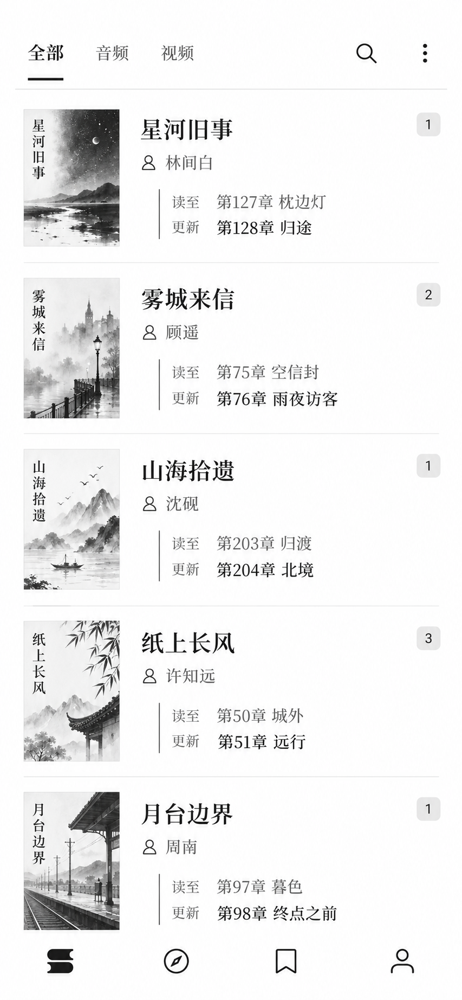
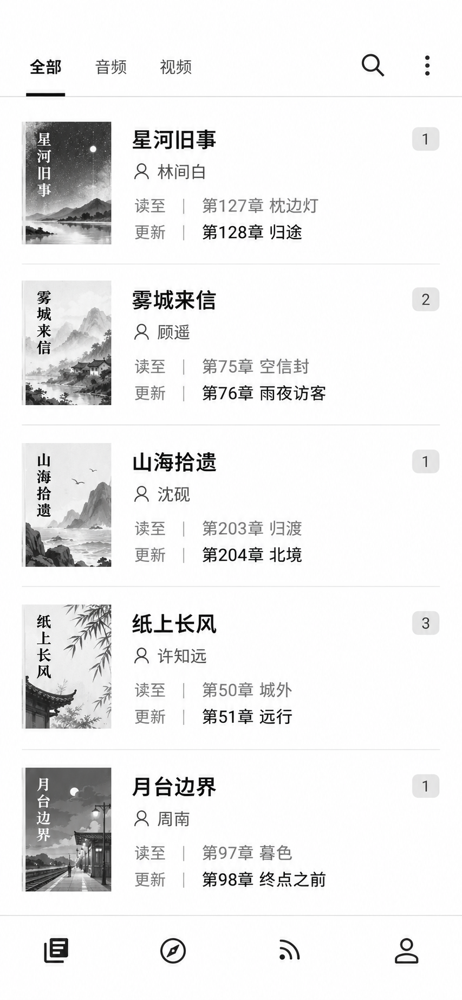
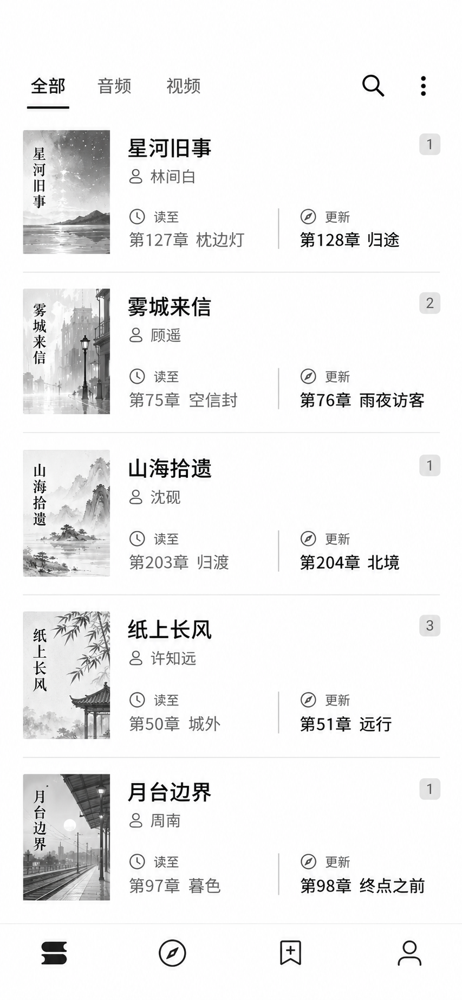

# Android 书架同列表视觉概念

## 本轮范围

用户指出，二列、三列和紧凑布局都是 Legado 已有的显示选项；此前用普通列表、网格、紧凑列表区分方案，只是在比较现成功能，不构成新的设计探索。此前三张图已失效，不作为本轮方案交付。

本轮三张图都保留同一个普通单列书架、原有导航和相同书籍字段，探索三种独立的视觉语言：书页边注、书目索引、章节对照。差异在标题字形、字段分组、对比关系和行内留白，不在已有布局模式。

## 参考与假设

[reference-md3-bookshelf.png](assets/reference-md3-bookshelf.png) 是本轮安装的官方 Legado 3.26.18 空书架截图，用于参考间距、排版和图标的完成度。它是设计质量参考，不是临摹目标；本方案不复制其大标题、五项导航或 Monet 配色。

[before-live.png](assets/before-live.png) 是本轮有内容的 Legado 书架截图，用于确认“全部 / 音频 / 视频”分组、搜索与更多、封面、书名、作者、当前章节、最新章节、未读数量及书架 / 发现 / 订阅 / 我的四项图标导航。

三图均用黑、白、灰阶先比较层级；不改变 Android 现有主题。示例书名、作者和章节为虚构数据。画布按 390×844 dp 内容区构图，不含手机外框、状态栏或系统导航栏。

## 方案比较与推荐

### 书页边注 — 推荐

18sp 中文系统衬线书名建立文学气质；作者作为轻次级信息；“读至 / 更新”两行以细竖线归组，最新章节保持更强前景。字段关系像页边注，标题与追更信息之间有清晰节奏。

代价是衬线与更大字号会减少行内可用宽度，需在真实字体缩放和较长书名、章节下校准。推荐把它作为本轮优先讨论方向，仍沿用原有普通列表和所有字段。

### 书目索引

无衬线标题、固定标签列和共同基线把作者、当前章节、最新章节组织成可快速扫读的信息索引。横向分隔形成稳定重复节奏，语义关系清楚。

代价是标签列占用文字宽度，长章节需要截短；整体气质更理性，也更像工具清单。

### 章节对照

每行把书名与作者放在上部，将“读至”和“更新”排成左右对照栏，强调当前进度与最新章节的关系。适合快速比较章节状态。

代价是两栏压缩了长章节名称的空间，长文本更容易截断；对照关系也会成为每一行的主要视觉焦点。

## 生成与验证边界

三张方案分别由内置 image_gen 独立生成，并将工具原始 PNG 直接复制到 assets，未裁切或缩放。以下保留三条生成 prompt 以便复现。图像是静态设计方案，不是应用实际渲染；未运行设备，也未验证运行时字号、字体回退、无障碍或长文本表现。

## 生成 prompt

### 书页边注

~~~text
Use case: ui-mockup
Asset type: standalone monochrome Android bookshelf concept for Legado-Z
Input images: Image 1 (reference-md3-bookshelf.png) is a visual-craft reference for clear spacing, restrained Android typography, and careful icon treatment only. Image 2 (before-live.png) is the structural source for existing Legado groups, search and overflow tools, 66dp book covers, metadata, unread badges, and the four original icon-only bottom destinations. Do not copy the large English page title, five-destination navigation, light blue selection color, status bar, system navigation bar, or the reference app’s palette.
Primary request: create the “书页边注” art direction for the existing ordinary vertical bookshelf list. Make it feel like a fresh, literary Legado reading index through typography and row composition, while preserving the familiar task and controls.
Scene/backdrop: clean flat white app-content canvas, no phone shell.
Subject: five book rows, each with a 66 dp wide, 3:4 portrait monochrome cover, author, current chapter, latest chapter, and a small unread-count badge. Use a 16 dp content margin. Book title is 18sp Chinese system-serif, medium weight and at most two lines. Author is a quieter secondary line. Place current and latest chapter as two aligned lines grouped by a fine vertical side-note rule; use short labels “读至” and “更新”. Keep chapter copy legible, with the latest line in darker, stronger foreground. The vertical rule and small labels should feel like book-page marginal notes, not a new panel or card.
Composition/framing: portrait app-content canvas equivalent to 390×844 dp; preserve the actual top group row “全部 / 音频 / 视频”, search and overflow positions, five single-column rows, then the four original icon-only bottom destinations in order: selected bookshelf book-stack, discovery compass, subscriptions bookmark, profile. No OS chrome.
Style/medium: refined native Android bookshelf interface, expressive but restrained editorial typography, carefully aligned baseline and generous row rhythm. The concept should feel visibly different in typography and information treatment while remaining the same ordinary list.
Color palette: strict black, white, and neutral grayscale only, including cover art, icons and unread badges.
Materials/textures: flat white surfaces, fine separators, small monochrome ink illustrations on covers, a single hairline beside each chapter-note group. No surface elevation.
Text (verbatim): selected group “全部”, other groups “音频”, “视频”. Five fictional entries:
“星河旧事” — author “林间白” — 读至 “第127章 枕边灯” — 更新 “第128章 归途” — unread “1”;
“雾城来信” — “顾遥” — 读至 “第75章 空信封” — 更新 “第76章 雨夜访客” — unread “2”;
“山海拾遗” — “沈砚” — 读至 “第203章 归渡” — 更新 “第204章 北境” — unread “1”;
“纸上长风” — “许知远” — 读至 “第50章 城外” — 更新 “第51章 远行” — unread “3”;
“月台边界” — “周南” — 读至 “第97章 暮色” — 更新 “第98章 终点之前” — unread “1”.
Constraints: preserve the app’s group → ordinary vertical book list → four-destination bottom navigation relationship; keep all five data fields in each row and covers at exactly 66 dp wide with 3:4 proportions. Use the image references as guidance, not as a tracing target.
Avoid: grids, alternate column counts, compact-mode density changes, oversized page headers, five-item navigation, new feature controls, cards, shadows, gradients, color, phone frames, status/system bars, large rounded containers, oversized continue-reading cards, floating bars, marketing copy, dates, English UI labels, watermark.
~~~

### 书目索引

~~~text
Use case: ui-mockup
Asset type: standalone monochrome Android bookshelf concept for Legado-Z
Input images: Image 1 (reference-md3-bookshelf.png) is a visual-craft reference for careful spacing and icon polish only. Image 2 (before-live.png) supplies the actual Legado grouping, search/overflow tools, book data fields, covers, unread counts, and four icon-only bottom destinations. Do not copy its colors, large English title, five-destination navigation, status/system bars, or any surface treatment from the reference.
Primary request: create the “书目索引” art direction for the same existing ordinary vertical bookshelf list. Emphasize calm, rational information indexing through sans-serif typography, strict shared baselines, and horizontal information divisions. This is a new visual hierarchy for the same list, not a change of bookshelf display mode.
Scene/backdrop: flat white app-content canvas, crisp Android interface, no phone frame.
Subject: five standard book rows. Every book has a 66 dp wide, 3:4 portrait monochrome cover at left, book title, author, current chapter, latest chapter, and unread-count badge. Use sans-serif Chinese typography throughout. Set titles at 16sp medium weight and align their left edges exactly. Place a smaller gray author line beneath. Under it, show two clearly indexed chapter rows with a fixed narrow label column (“读至”, “更新”) and aligned chapter values. Latest chapter value uses black stronger text; current-reading value uses medium gray. A small grayscale unread count sits at the upper right of each row.
Composition/framing: 390×844 dp equivalent portrait app-content screen, no OS status/navigation bars or shell. Top uses only the actual existing tabs “全部 / 音频 / 视频” plus search and overflow. Center is one single vertical list of five equally spaced rows, 66×88 dp covers, consistent content edges and text baselines, fine horizontal row dividers. Bottom is the four original icon-only destinations in the original order: bookshelf, discovery, subscriptions, profile.
Style/medium: modern, precise, editorial-index UI. The distinct visual language comes from typographic alignment, repeated label/value columns and horizontal section rhythm; keep the same normal list structure and the same book data density.
Color palette: pure black, white, and neutral grayscale only, including all covers, icons, and badges.
Materials/textures: flat white canvas, fine hairline separators only, small monochrome ink cover illustrations; no shadows or card surfaces.
Text (verbatim): selected group “全部”; groups “音频” and “视频”. Five fictional books with metadata:
“星河旧事”, author “林间白”, 读至 “第127章 枕边灯”, 更新 “第128章 归途”, unread “1”;
“雾城来信”, author “顾遥”, 读至 “第75章 空信封”, 更新 “第76章 雨夜访客”, unread “2”;
“山海拾遗”, author “沈砚”, 读至 “第203章 归渡”, 更新 “第204章 北境”, unread “1”;
“纸上长风”, author “许知远”, 读至 “第50章 城外”, 更新 “第51章 远行”, unread “3”;
“月台边界”, author “周南”, 读至 “第97章 暮色”, 更新 “第98章 终点之前”, unread “1”.
Constraints: preserve the existing group → ordinary single-column list → four-destination bottom navigation relationship and all five fields. Keep the cover width 66 dp and aspect ratio 3:4. Use clean repeated baselines and never let a chapter field disappear.
Avoid: grid or multiple book columns, compact-mode density changes, serif or calligraphic title type, new features, changed navigation, large page header, color, gradients, shadows, cards, rounded panels, oversized continue-reading card, floating bar, marketing copy, status/system bars, phone shell, dates, English UI text, watermarks.
~~~

### 章节对照

~~~text
Use case: ui-mockup
Asset type: standalone monochrome Android bookshelf concept for Legado-Z
Input images: Image 1 (reference-md3-bookshelf.png) is a visual-craft reference for precise spacing and icon finish only. Image 2 (before-live.png) is the source for existing Legado group tabs, toolbar actions, book data fields, unread counts, and four icon-only bottom destinations. Keep the structure of the actual four-destination app. Do not copy the reference’s empty-state message, oversized English title, five navigation items, blue color, status bar, or system navigation bar.
Primary request: create the “章节对照” art direction for the same ordinary vertical bookshelf list. Make the relationship between current-reading and latest chapters the main visual idea, while retaining a conventional one-book-per-row list and the same density as the other two concepts.
Scene/backdrop: flat white app-content canvas with no phone frame.
Subject: five vertically stacked normal bookshelf rows, each with a 66 dp wide 3:4 portrait grayscale cover at left; the right side contains book title and author together near the top, followed by two compact chapter information columns side-by-side. The left chapter column is labeled “读至” and shows current-reading progress; the right is labeled “更新” and shows the latest chapter in stronger black type. A fine vertical rule between these two text fields clarifies their comparison. Keep the unread count badge in the upper-right area of each row.
Composition/framing: app-content portrait canvas equivalent to 390×844 dp. Preserve existing top group tabs “全部 / 音频 / 视频”, search and overflow tools, five standard single-column rows, and original bottom icon-only navigation “书架 / 发现 / 订阅 / 我的” in that order. Keep the same 66×88 dp cover size, five-row count and row spacing as the other concepts.
Style/medium: a clear comparative reading index with neat sans-serif typography. Chapter comparison is expressed within each ordinary row, never as multiple book columns. Give the paired chapter labels a fixed alignment and a light divider. The concise layout should make the relationship legible, while some long chapter titles may be visibly abbreviated, showing the tradeoff of side-by-side comparison.
Color palette: pure black, white, and neutral grayscale only. Covers, icons, and unread badges all monochrome.
Materials/textures: no cards, no shadow; only fine light-gray separators between book rows and a thin divider between the two chapter fields; restrained monochrome line-art covers.
Text (verbatim): top tabs selected “全部”, “音频”, “视频”. Five fictional book records:
“星河旧事” / author “林间白” / 读至 “第127章 枕边灯” / 更新 “第128章 归途” / unread “1”;
“雾城来信” / “顾遥” / 读至 “第75章 空信封” / 更新 “第76章 雨夜访客” / unread “2”;
“山海拾遗” / “沈砚” / 读至 “第203章 归渡” / 更新 “第204章 北境” / unread “1”;
“纸上长风” / “许知远” / 读至 “第50章 城外” / 更新 “第51章 远行” / unread “3”;
“月台边界” / “周南” / 读至 “第97章 暮色” / 更新 “第98章 终点之前” / unread “1”.
Constraints: preserve all existing bookshelf fields, group controls, and four-destination bottom navigation; show one book per row, with the same standard-list cover size and five-row density as the other designs.
Avoid: grid, multiple book columns, compact mode, changing bookshelf features, changing navigation destinations, missing or hidden fields, color, gradients, shadows, cards, rounded panels, oversized continue-reading card, floating bar, marketing copy, status/system bars, phone shell, dates, English UI labels, watermarks.
~~~
